# Outline: subjects still to cover

Internal notes, not published. Each entry lists what to cover, where it lives in
the code, and a figure that would help. Nothing here is final prose.

The published series lives in `posts/`; this file is the backlog of material that
exists in the code but is not yet in any part.

### 2. Downsampling by character  — *covered in Part 5*

`load` samples a fraction of characters and keeps **all** their rows. The post
now has a subsection ("Why the sample is drawn by character") with the figure
`images/sampling.png`; what follows is the material behind it.

- Why sampling rows breaks the monthly timeline (a character would appear to have
  gaps that are sampling artefacts, not churn).
- `sample_by_user` and the fixed `seed=42`.
- The cost/accuracy trade-off: 10% of characters by default, `--fraction 1` for
  everything.

Measured on `data/wowah_data_2008.parquet` (10.8M heartbeats, 37,354 characters,
98,972 character-months), 10% sample, `seed=42`:

| | rows | characters | character-months | lost |
|---|---:|---:|---:|---:|
| full | 10,826,734 | 37,354 | 98,972 | — |
| by character | 1,115,791 | 3,735 | 9,959 | 0 |
| by row | 1,082,673 | 20,472 | 59,690 | 24% of the played cells |

- 13.9% of the row-sampled characters get an interior hole, 1.85 months wide on
  average.
- Label corruption: 5,519 of 16,701 positives in the row sample are spurious
  (33%), 0 true positives lost — precision 0.67, recall 1.0 against the true
  labels. The corruption only invents churners.
- The parse happens before the sample, so both schemes cost the same to parse and
  about the same to fit.

Code: `sample_by_user` and `load`, in `src/utils.py` and `main.py`.

Figure: `images/sampling.png`, drawn by `plotting/plot_sampling.py`
(`pixi run plot-sampling`). One panel: a 10% row sample over 2008 for 40
characters drawn at random from the 20,472 the sample kept (a snippet — the
sample kept far more than can be drawn). Blue = kept, orange = played but
dropped, grey = did not play.

### 3. What a "session" is  — *covered in Part 3*

The post says `SessionEncoder` "groups consecutive heartbeats into sessions" but
never defines the boundary, which is a tuned hyperparameter.

- A session ends after `session_gap` minutes without a heartbeat; the default is
  30, and `{15, 30, 60}` are the tuned options.
- Heartbeats arrive roughly every 10 minutes, so the gap choice is not arbitrary
  — show the gap histogram.
- `get_session_duration`: sessions that start and end on the same heartbeat get a
  duration of 1 minute rather than 0, so that "logged in briefly" is
  distinguishable from "never logged in".
- The zone-session encoder (`split_by=["char", "zone"]`) used for location
  features is a *second*, independent sessionisation.

Code: `build_feature_table` and `session_gap` in `main.py`, `get_session_duration`
in `src/utils.py`, and `add_session_features` in `adding_features.py`.

The whole path, from a raw heartbeat table to a row of session features
(`session_features.mmd` at the repository root, rendered to
`images/session_features.svg`):

{fig-align="center"}

Three points are easy to miss in the diagram:

- The encoder is **stateless and column-adding**. It sorts the month's beats per
  character, takes the diff to the previous beat, and starts a new session where
  the diff exceeds `session_gap`. Every row, and its original order, survives.
- `session_gap` is a **skrub choice**, so the search tunes the definition of a
  session exactly like any other hyperparameter, and the encoder is refit for each
  month.
- The **second** encoder, split by `(char, zone)`, is what feeds the location
  features: it measures how long a character stayed in a given zone, not how long
  it played.

#### Worked example: from beats to a row

The night below is character 66560 on 2008-03-14, with `session_gap = 30`
minutes. The 50m 14s gap crosses the threshold and opens session 1; the 20m 18s
gap does not.

| beat | gap to previous | session |
|--------|-----------|:-----:|
| 21:51:06 | — | 0 |
| 22:00:50 | 9m 44s | 0 |
| 22:11:23 | 10m 33s | 0 |
| 22:21:07 | 9m 44s | 0 |
| 23:11:21 | 50m 14s | 1 |
| 23:21:04 | 9m 43s | 1 |
| 23:41:22 | 20m 18s | 1 |
| 23:51:05 | 9m 43s | 1 |

The same night at 15 and 60 minutes gives three sessions and one session
respectively, which is what the `images/session_gap_example.png` figure shows.
Over the whole month, the character has 9 sessions, and `add_session_features`
reduces them to a single (char, month) row:

| session | start | end | duration |
|:--:|-----------|-----------|------|
| 0 | 03-01 09:08 | 03-01 11:38 | 2h 30m |
| 1 | 03-01 22:28 | 03-01 22:28 | 1m |
| 2 | 03-05 21:41 | 03-05 22:21 | 39m 45s |
| 3 | 03-08 10:40 | 03-08 11:31 | 50m 14s |
| 4 | 03-09 08:41 | 03-09 11:31 | 2h 50m |
| 5 | 03-09 12:11 | 03-09 13:41 | 1h 30m |
| 6 | 03-14 21:51 | 03-14 22:21 | 30m 01s |
| 7 | 03-14 23:11 | 03-14 23:51 | 39m 44s |
| 8 | 03-15 11:11 | 03-15 11:41 | 29m 57s |

→ the features attached to that character's **April** row:

| feature | value |
|----------------------------------|-----------|
| `monthly_num_sessions` | 9 |
| `monthly_total_session_duration` | 10h 01m |
| `monthly_avg_session_duration` | 1h 07m |
| `monthly_std_session_duration` | 58m 02s |
| `monthly_avg_session_start` | 02:20 |
| `monthly_avg_session_end` | 03:27 |

Session 1 is a single heartbeat, which is why `get_session_duration` gives it one
minute instead of zero. Two caveats on the aggregates: the standard deviation is
computed on microseconds because polars cannot take the std of a `Duration`
column, and `monthly_avg_session_start` / `_end` are means of timestamps over
different days, so they only carry a time-of-day signal.

::: {.callout-note}
**Figure placeholder** — `images/TODO-session-gap.png`

Reuse `reports/exploration/heartbeat_gaps.png` (already generated by
`explore_data.py --plots gaps`), with vertical lines at 15/30/60 minutes to show
where the candidate thresholds fall relative to the gap distribution.
:::

### 4. Location features in depth  — *covered in Part 4*

The post lists location features in one bullet. They are the most involved part
of the feature engineering and deserve their own subsection.

- **Zone rarity**: `log(N / n_v)` where `N` is the number of unique characters and
  `n_v` the number of unique visitors to the zone. High rarity = few visitors.
- **Hub definition**: a zone is a hub if its rarity is below the 10th percentile.
- **Per-character aggregates**: `max_rarity`, `mean_rarity`, and `in_hub` (the
  fraction of a character's zone-sessions spent in hubs).
- **Gini coefficient** over time spent per zone: low Gini = spread evenly across
  many zones ("casual explorer"), high Gini = concentrated in few zones
  ("grinding"). Note that `add_gini` is set in `make_data_op` and is off by
  default, so the coefficient is only computed when explicitly requested.
- Why this block is optional: it is the slowest part of the feature table.

Code: `get_zone_rarity`, `add_player_rarity`, `gini`, `get_location_gini` and
`add_location_features` in `adding_features.py`, and `add_gini` in `make_data_op`.

::: {.callout-note}
**Figure placeholder** — `images/TODO-zone-rarity.png`

Scatter of zones: x = number of unique visitors (log scale), y = rarity, with the
10th-percentile hub threshold drawn as a horizontal line and the hub zones
labelled. A second small panel: distribution of per-character Gini, split by
whether the character churned.
:::

### 5. The model and the encoder  — *covered in Part 5*

The post never names the model. It jumps from "the plan" to a results table.

- `TableVectorizer` on the assembled feature table: what it does to the
  categorical columns (race, class, most-frequent zone, guilds) and to the
  duration columns.
- `HistGradientBoostingClassifier` as the estimator, and why a gradient-boosted
  tree model suits this table (mixed types, nulls, non-linearities, no scaling
  needed).
- The single tuned model hyperparameter: `learning_rate` in `[0.1, 0.5]`,
  log-uniform.
- `roc_auc` as the scoring function, and why AUC rather than accuracy given the
  base rate.

Code: `TableVectorizer`, `HGB` and `with_scoring` in `make_data_op`.

::: {.callout-note}
**Figure placeholder** — `images/TODO-model-graph.svg`

The skrub plan graph for `make_data_op`, rendered with
`data_op.skb.draw_graph()`. Note that `images/model_graph.svg` in the repo is a
stale graph from a different project (`read_csv`, `LogisticRegression`) and must
not be reused.
:::

### 6. Base rate and class balance  — *covered in Part 5*

The post gives AUC values without saying what a trivial model would score.

- `churn_next` is true for about 36.5% of rows in the 2008 churn dataset
  (81,199 rows, 10 months), and `has_played` is true for about 58%.
- So AUC 0.5 is genuinely chance, but accuracy 0.64 is also achievable by
  predicting "not churned" always. Say which metric is being reported and why.
- The distribution of `churn_next` by month, to show that the base rate drifts.

Code: `build_churn_dataset` in `add_churn.py`, and `with_scoring("roc_auc")` in
`make_data_op`.

::: {.callout-note}
**Figure placeholder** — `images/TODO-base-rate.png`

Two panels: (a) monthly `churn_next` rate as a line over the test months;
(b) the same with the AUC curve overlaid on a secondary axis, so the reader can
see whether score changes track base-rate changes.
:::

### 7. Why only characters active in the previous month  — *covered in Part 5*

The post now scores only characters that played in the previous month
(`only_prev_active=True`), and explains why in a callout. The numbers behind
the choice are only quoted, not shown.

- Keep the results of the old definition (all rows, 221,237 rows in the 2008 data,
  54.5% positive) next to the new ones (81,199 rows, 36.5% positive), per test month.
- 75% of the old positive rows were already absent in the previous month, and the
  trivial rule "absent last month" gets ROC AUC 0.63.
- The new scores are higher, not lower. On the same test rows (characters active in M-1),
  a model trained on all rows scores 0.64 to 0.82 depending on the month, versus 0.82 to
  0.90 when trained on active rows only. The rows with no features do not make the
  problem easier, they pollute training; the cause is not tested.
- This is the number that matters operationally: you can only retain characters
  who are still around.

Code: `build_churn_dataset` and `only_prev_active` in `add_churn.py`, and
`make_data_op` in `main.py`.

::: {.callout-note}
**Figure placeholder** — `images/TODO-auc-split.png`

Grouped bar chart per test month: AUC with the old definition (all rows) vs. the
new one (rows with `prev_played == True`). The gap between the two bars is the
point of the section.
:::

### 8. Hyperparameter tuning  — *covered in Part 5*

`Dependencies` mentions Optuna, and `random_search` exists, but the post only ever
shows default hyperparameters.

- `random_search`: Optuna backend, `n_iter=16`, `n_jobs=-1`, results persisted to
  `wowah_churn_study.db`.
- The search space: `session_gap`, `location_features`, `lags`, `learning_rate`.
- What the search actually found, and whether the tuned plan beats the default.
- The honest caveat: tuning on the same folds you report is optimistic.

Code: `random_search` in `main.py`; the search space is declared in
`make_data_op` with skrub's `choose_from`, `choose_bool` and `choose_float`.

::: {.callout-note}
**Figure placeholder** — `images/TODO-optuna.png`

Optuna's parallel-coordinate plot or parameter-importance bar chart from
`wowah_churn_study.db`, plus a table of best-vs-default AUC per test month.
:::

### 9. Held-out evaluation on unseen files  — *covered in Part 6*

This is the most distinctive part of the design and it is entirely absent from
the post.

- `HISTORICAL_END = 2008-10-31` vs. `UNSEEN_START = 2008-10-01` /
  `UNSEEN_END = 2009-01-10`: the two windows overlap by one month on purpose, so
  that November's features (built from October) are not degenerate.
- `predict_unseen` fits the whole graph — parsing included — on the historical
  files, then calls `.predict()` with the unseen environment. The same code path
  parses files it has never seen.
- Why January 2009 stops on the 10th, and why that caps the last usable target at
  December 2008.
- The row-order trick used to recover `(char, month)` for each prediction.

Code: `HISTORICAL_END`, `UNSEEN_START`, `UNSEEN_END`, `get_env` and
`predict_unseen` in `main.py`.

::: {.callout-note}
**Figure placeholder** — `images/TODO-train-unseen-timeline.png`

A single horizontal timeline, 2006-01 → 2009-01, with three bands: "train"
(2006-01 → 2008-10), the one-month overlap (2008-10), and "unseen"
(2008-10 → 2009-01). Mark the incomplete January 2009 tail with a hatch. This
replaces the ambiguity in the current `diagram-months-churn.png`.
:::

### 10. Reading the execution report  — *covered in Part 6*

`main.py` writes a skrub report to `reports/execution_report/` on every
`evaluate()` run. The post never mentions it, but it is the easiest way for a
reader to inspect the plan.

- What the report contains: the plan graph, per-node timing, the fitted
  transformer state.
- How to open it (`reports/execution_report/index.html`).
- Which node dominates the runtime (expected: the location features).

Code: `data_op.skb.report` in `evaluate`.

::: {.callout-note}
**Figure placeholder** — `images/TODO-execution-report.png`

A screenshot of `reports/execution_report/index.html` with the slowest node
highlighted, plus a small table of per-node wall time.
:::

### 11. Data quality and quirks  — *covered in Part 6*

Several decisions in the code are responses to data problems that the post never
mentions.

- `guild == -1` means "no guild" and is mapped to null in `make_data_op`.
- Duplicate heartbeats at the same timestamp (visible as the `0s (duplicate)` bar
  in the gap histogram).
- The level cap moves: 60 → 70 in April 2007, 70 → 80 in November 2008. Any
  level-based feature is therefore not comparable across the whole window.
- Expansion releases are a confounder: they cause both an influx of characters
  and a change in behaviour. The post mentions them but never uses them.

Code: the `guild == -1` mapping in `make_data_op`, and `EXPANSIONS` in
`explore_data.py`.

::: {.callout-note}
**Figure placeholder** — `images/TODO-levels-and-expansions.png`

Reuse `reports/exploration/levels_over_time.png` (already generated by
`explore_data.py --plots levels`). It already annotates both expansions and shows
the two cap changes.
:::

### 12. Reproducing the post  — *covered in Part 6*

There is no "how to run this" section.

- The `pixi` tasks and the `main.py` CLI: `--env {train,unseen,predict-unseen}`
  and `--fraction`.
- `explore_data.py` for the exploration figures.
- Determinism: `seed=42` in `sample_by_user`; the model itself is not seeded, so
  AUC varies by a few hundredths between runs (already noted in the results
  section).
- Runtime expectations, so a reader knows whether 10% is a reasonable default.

Code: the `argparse` block in `main.py`, `seed` in `sample_by_user`, and
`parse_args` in `explore_data.py`.

::: {.callout-note}
**Figure placeholder** — none. A short code block with the three commands is
enough.
:::

### 13. Limitations and what would come next  — *covered in Part 6*

The post ends on the results table. A closing section would make the write-up
more honest and more useful.

- Right-censoring: characters still active at the end of the window have no
  observed churn, and the last months are dropped entirely.
- Avatars are treated as players; a player with several avatars is counted
  several times, and churn on one avatar is not churn on the player.
- No causal claim: the post cannot measure whether an incentive would have
  worked, only who is at risk.
- The monthly granularity is a modelling choice; weekly would give more folds but
  a noisier label.
- A survival-analysis framing (time-to-churn) would use the censored rows that
  the current setup throws away.

Code: the `churn_next` nulling and the dropping of null targets in
`build_churn_dataset`.

::: {.callout-note}
**Figure placeholder** — `images/TODO-censoring.png`

A per-character timeline diagram: a few characters as horizontal bars, with the
observation window shaded, showing (a) a character who churns inside the window,
(b) one who is still active at the end (censored), and (c) one who starts late.
:::

### 14. Caching the plan  — *covered in Part 6*

Drafted in full in Part 6; this entry is the pointer.

- The parse is a **node of the plan**, so `cross_validate` re-parses on every
  evaluation: 31 folds × 2 + 1 = **63 parses** of 132,042 files, ~71 minutes.
- `skrub.set_config(cache=...)` takes that to one parse. Cache off → on is about
  **15× faster**; cold → warm is only about **26%**, because the rest is fitting.
- The cache does **not** invalidate when the code changes: joblib keys on the
  cached function's own source. `_source_fingerprint` puts the dependencies back
  into the key; `load` is deliberately left out because the parser is frozen.
- The cache is 587 MB and git-ignored. Deleting it is always safe and costs a full
  recompute.

Code: `CACHE_DIR`, `_source_fingerprint` and `FEATURES_FINGERPRINT` in `main.py`,
and `load` and `make_data_op`.

::: {.callout-note}
**Figure placeholder** — none. A table of the three cache states (off / cold /
warm) with wall time and parse count is enough; it is already in the section
file.
:::
