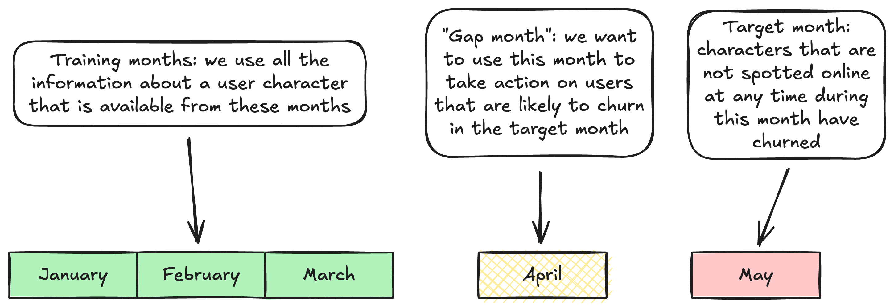
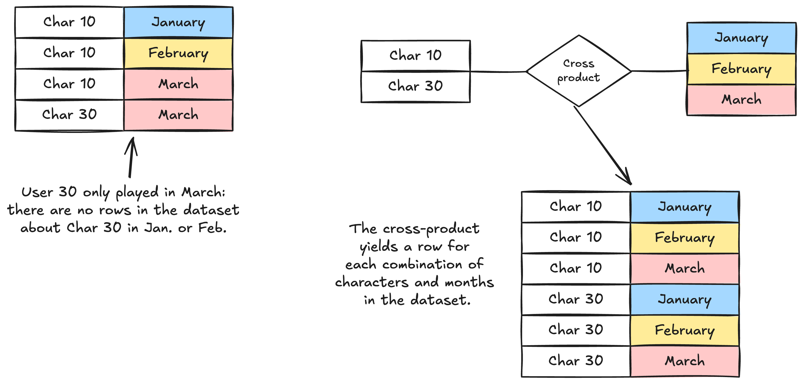
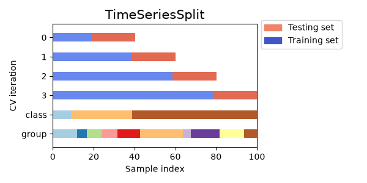
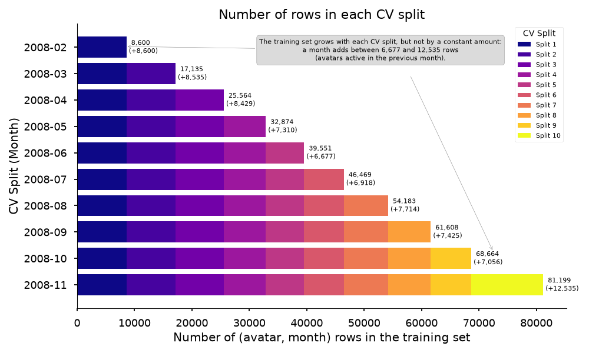

```{python}
#| echo: false
import inspect
from IPython.display import Markdown, display


def show(*objs):
    """Display the source code of the repository functions used in this post."""
    src = "\n\n".join(inspect.getsource(o) for o in objs)
    display(Markdown(f"```python\n{src}\n```"))
```

In this blog post we will see how we can predict player churn in World of Warcraft 
(WoW), a subscription-based MMORPG released in 2004. More precisely, we are 
interested in predicting a player's behavior in a given month, and decide whether 
there is a risk that they will stop playing the next month. 
To do so, we want to train a machine learning model that, given features based 
on each player's behavior and on the overall playerbase, will be able to predict
whether player X will stop playing in a given month. 


::: {.callout collapse="true"}
### Dependencies

Through the post we will build a full machine learning pipeline: we use  
polars for dataframe operations; [skrub](https://skrub-data.org/stable/) is used
for data exploration, feature engineering and constructing the overall execution
plan through its [Data Ops framework](https://skrub-data.org/stable/data_ops.html); 
[scikit-learn](https://scikit-learn.org/stable/index.html) is imported for the
actual ML model; hyperparameter optimization is done using [Optuna](https://optuna.org)
through skrub's Data Ops. 

:::

To keep the focus of this post on the process rather than the code, most of the 
lower-level functions will be hidden in collapsible blocks, including much of 
the pre-processing and feature engineering.
The entire code is available in this [repository](https://github.com/rcap107/wowah-sessionization).

## The dataset
We rely on the [World of Warcraft Avatar History](https://qualinet.github.io/databases/world_of_warcraft_avatar_history_dataset/)
dataset.
The dataset is built by scanning the game's servers roughly every 10 minutes, and
logging information about each **user character** in the Horde faction that is
found online at the timestamp's time. As we have a sequence of timestamps, this 
lets us track the behavior of players over time. 

::: {.callout-note}
#### Expansions and Taiwanese release

WoWAH was collected on the Taiwanese server *Light's Hope*, so it follows the
Taiwan/Hong Kong release schedule rather than the North American/European one: 
importantly the first expansion (*The Burning Crusade*) launched in April 2007 rather than 
in January; the second expansion (*Wrath of the Lich King*) released in November 
2008 in both cases. 

Expansion releases are important events in the dataset, as they introduce new content
and represent a major influx of new and old players. 
:::


#### Players, player characters and avatars

Through this write-up, we will use the terms "character" and "avatar" **interchangeably**:
both terms will be used to refer to any single player-controlled character that 
is found online when the server snapshot is taken. 

Avatar information includes:

- The avatar's ID (a unique integer ID for anonymization)
- The ID of the avatar's guild (possibly missing)
- The avatar level at that moment in time
- The avatar's class (Hunter, Mage, Warlock etc.)
- The avatar's race (Blood Elf, Undead, Tauren etc.)
- The avatar's location in the game's world


::: {.callout-note collapse="true"}
#### Parsing the data

The dataset is stored in folders grouped by day and quarter, and logs are stored
as txt files that contain info about each avatar found online at the given timestamp.
As the formatting is not standard (not even a csv!), the pre-processing is non-trivial.

Data Ops can still help with this, and indeed we include parsing the files in our
pipeline. However, for convenience we publish a
[separate script](https://github.com/rcap107/wowah-sessionization/blob/main/src/parse_to_single_table.py),
to convert the text files in parquet, and we publish the resulting dataframe on
[Kaggle: World of Warcraft Avatar History 2006-2009](https://www.kaggle.com/datasets/ryye107/world-of-warcraft-avatar-history).

::: {.columns}

::: {.column}

**Folder structure**

```
WoWAH
├── 2006_01_03
│   ├── 2006-01-01
│   │   ├── 00-03-56.txt
│   │   ├── 00-13-43.txt
│   │   ├── 00-23-48.txt
│   │   ├── 00-33-48.txt
│   │   ├── ...
│   ├── 2006-01-02
│   ├── ...
├── 2006_04_06
├── ...
```


:::

::: {.column}

**Content of a single log file**

```
# head WoWAH/2006_01_03/2006-01-01/00-03-56.txt 
Persistent_Storage = {
	[1] = "0, 12/31/05 23:59:46, 1,0, , 5, Orc, Warrior, Durotar, no, 0",
	[2] = "0, 12/31/05 23:59:46, 1,1, , 9, Orc, Shaman, Durotar, yes, 0",
	[3] = "0, 12/31/05 23:59:52, 2,2, , 13, Orc, Shaman, Durotar, no, 0",
	[4] = "0, 12/31/05 23:59:52, 2,3,0, 14, Orc, Warrior, Durotar, no, 0",
	[5] = "0, 12/31/05 23:59:52, 2,4, , 14, Orc, Shaman, Durotar, yes, 0",
	[6] = "0, 12/31/05 23:59:52, 2,5, , 16, Orc, Hunter, The Barrens, yes, 0",
	[7] = "0, 12/31/05 23:59:52, 2,6, , 18, Orc, Warlock, The Barrens, no, 0",
	[8] = "0, 12/31/05 23:59:52, 2,7, , 17, Orc, Hunter, Silverpine Forest, yes, 0",
...
```


:::

:::


:::


### A quick exploration of the dataset
We begin by loading the historical dataset with all the timestamps. To keep the
examples fast, this post uses the year 2008 (about 10.8M rows, 37k characters); the
repository can also run everything on the full 2006-2009 dataset (35.6M rows, 90k
characters). We use `.scan_parquet()` because it returns a `LazyFrame`, which
we want to use as much as possible through the code for query optimization. 

```{python}
from skrub import TableReport
import polars as pl

df = pl.scan_parquet("data/wowah_data_2008.parquet")
# we collect the dataframe because the TableReport does not accept LazyFrames
TableReport(df.collect())
```

Skrub's `TableReport` gives a quick view of many statistics we may be interested
in when we explore a dataset. 
We can get information on the shape of the dataframe (almost 11M rows), the 
data types we are working with as well as the distribution of categorical and 
numerical values. The level cap of 70 is immediately evident as the median of the 
"level" column.

By itself, this dataset includes a wealth of information about player habits and 
behaviors, but exploring such information goes beyond the scope of this post. As
such, we will only focus on what is most relevant to the task of predicting player
churn. 


## Modeling player churn


Modeling user churn is a common application of machine learning models, though 
the definition of churn is typically business-specific. In general, by "user churn"
one refers to "a user that does not come back to the service for a certain length 
of time".

In the context of this example, churn refers to **those avatars that are not found
online for at least two consecutive months**: we consider those characters as 
users that stopped playing, and consequently suspended their subscription.  


::: {.callout-important}

In WoW, a single player may have multiple "player characters" or "avatars". The
information available in the dataset does not allow us to link a player to their
avatars, and as such we will treat **each avatar as an independent player**. 

This is reflected in how we model churn: as we do not have access to which player
is behind each avatar, we assume that **any churned avatar is a churned player**.

:::

As we do not have access to the actual subscription data, we assume that a player 
has suspended their subscription when they stop playing for **two consecutive 
months**. A single missing month is more likely a break than a cancellation, so
a character that skips a month and then comes back is not considered churned. 

For this post, we aggregate player behaviors at a monthly basis, and add a `has_played`
flag that tells us if a player has played at least once during each month. From it, 
we derive two columns:

- `churn`: the character has *churned as of this month*, i.e., `has_played` is `False` 
  both in this month and in the previous one.
- `churn_next`: the value of `churn` in the *following* month. This is the target 
  that we want to predict.


::: {.callout-important}

**Our objective**

Given a month (e.g., **June**), we want to use all the data up to the last day of the 
previous month (all months until **May** included) to predict whether a user will have 
churned as of **July** (i.e., their `has_played` flag will be `False` both in June and 
in July).

In other words, a row at month M means **"act during month M, using data up to the end of M-1, to predict absence in M and M+1."**


:::



The idea is that, by knowing that user X is likely to churn, we should be able to 
use the month of June to apply some incentive to the user so they won't churn. 
Note that, in the diagram, a character that is absent in the target month has only
churned if it was also absent in the "gap month".

::: {.callout-warning}
#### Why we're predicting one month in the future

Given the month of **June**, we may be tempted to use `churn` at this month as the
target. However, June's features are built from **May**, and `churn` for June _is 
only true if the character is absent in May_: any character that is active in May
is labeled as "not churned" by construction, and the model would learn that just by
looking at the missing values. This would produce overly optimistic results. 

Shifting the target to **July** avoids this problem: in _June_ we want to predict
whether a player is active in _July_ using data from and up to _May_.

:::

One caveat with this modeling strategy is that we are working with 
**historical data**, so we cannot actually apply said incentive and observe whether 
it has an impact like in a typical [A/B test](https://en.wikipedia.org/wiki/A/B_testing). 

### Building the churn dataset
We begin by adding two columns to the historical dataset: in the first we store 
each timestamp, truncated to have a monthly resolution; in the second we track the 
first month for each character. Additionally, we add a constant `has_played` column
that acts as our "player was seen" flag. 

We are interested in monthly snapshots, so the dataset is then reduced to select
only the unique (character, month) pairs. 

::: {.callout collapse="true"}
#### Data preparation (click to expand)

```{python}
#| echo: false
from add_churn import make_data
show(make_data)
```

```{python}
data = make_data(df)
```

:::

Since we want to predict the behavior a player will have over a single month, our
target variable will be grouped by "user-month" (e.g., `ID153_2026-12`). However, 
not all players will play at least once every month, so by relying exclusively 
on the historical data we would be missing samples; to get around this problem 
we generate a `char_month` dataset that contains all unique combinations of users
and months by executing the cross-product between the unique users and the range
of months. 



::: {.callout collapse="true"}

### Cross product (click to expand)

The cross product between two sets (in this case, months and unique users) 
builds a new set where each element in the first set is paired with all elements
in the second set. 

```{python}
import polars as pl
df1 = pl.DataFrame({"col": [1,2,3]})
df2 = pl.DataFrame({"col": ["a","b"]})
df1.join(df2, how="cross")
```

:::

::: {.callout collapse="true"}
#### Generate all unique combinations of users and months (click to expand)

```{python}
#| echo: false
from add_churn import make_user_month
show(make_user_month)
```

```{python}
user_month = make_user_month(df)
user_month.collect()
```

:::


The grid extends three months past the end of the data. These extra months only 
exist so that lagged features can be computed on months without data, and the 
rows are dropped later because their target is unknown.

Now that we have all the combinations (character, month), we can join back the 
prepared data to mark all the months in which each character was found online, 
and marking all others with `has_played=False`. 

Additionally, the resulting rows are filtered to remove all pairs (char, month) 
whose `month` precedes the character's first month. We should not have a row 
about a character's playtime in January if they started playing in August! 

Then we add the churn information. After sorting by month, `prev_played` is the 
`has_played` flag of the previous month for the same character (`False` for the 
first month), `churn` marks the characters absent in both months, and `churn_next` 
is `churn` shifted one month back within each character. The last month in the data 
has no "next month" to look at, so its `churn_next` is left empty. 


::: {.callout collapse="true"}
#### Add the churn columns (click to expand)
```{python}
#| echo: false
from add_churn import add_churn
show(add_churn)
```

```{python}
r = add_churn(user_month, data)
r.collect()
```

:::

Finally, we can put everything together in a single function that takes the 
historical data as input and returns a dataset with the churn indication as output. 
It also calls `remove_unrealistic_entries`, a safety check that removes the rows 
preceding a character's first month and selects the final columns. Rows without 
a target are dropped, since they can be used neither for training nor for evaluation:

```{python}
#| echo: false
from add_churn import build_churn_dataset, remove_unrealistic_entries
show(build_churn_dataset)
```

```{python}
churn_data = build_churn_dataset(df)
churn_data
```

This dataframe contains a row for each (character, month) starting from that 
character's first month up until the second-to-last month of the dataset. In each 
row, `has_played` informs us of whether the character logged in at any time in that 
month, and `churn_next` is the target that we want to predict on a monthly basis. 

## Setting up the ML pipeline
Before starting with feature engineering and actually training the model, it's 
worth spending some time understanding the scenario we are in. 

The main factor that complicates this scenario is the fact that we are dealing
with sequential data points, which are therefore not independent of each other: 
*the position of a player at a time T is strongly correlated with their position
at time T+1*. 

### Building a custom splitter
For this reason, we need to use a splitter that returns sequential splits. A 
common example of this is scikit-learn's
[TimeSeriesSplit](https://scikit-learn.org/stable/modules/generated/sklearn.model_selection.TimeSeriesSplit.html). `TimeSeriesSplit` works by splitting the entire dataset in a given number 
of splits; during cross-validation, at step K the splitter returns the first k
splits as the train split, and the k+1 split as the validation split. 

{fig-align="center"}

[Source](https://scikit-learn.org/stable/auto_examples/model_selection/plot_cv_indices.html#sphx-glr-auto-examples-model-selection-plot-cv-indices-py)

A downside of `TimeSeriesSplit` is that the splitter assumes uniformly distributed
samples, so that each singular split has the same size as the others. This is a 
problem for our scenario: our samples are (character, month) pairs, and the number
of characters in each month is never constant and indeed increases over time: 

{fig-align="center"}

For this reason, we need to define a custom splitter that is aware of the constraints
we are working with. Given that we are working month-by-month, each split should
contain all the characters that played in a specific month, and should be able to
do so regardless of the fact that the number of characters changes.

There is a second constraint: the target of a row is the churn status of the 
*following* month, so it is only known one month later. If the training set included 
the rows of the month right before the test month, their targets would be computed 
from the activity in the test month. The splitter therefore leaves a one-month gap 
between the last training month and the test month.

This is what we implement here: 

```{python}
#| echo: false
import main

display(Markdown(
    f"The boundaries of the experiment are defined in `main.py`: split points go "
    f"from {main.MIN_DATE:%Y-%m-%d} to {main.MAX_DATE:%Y-%m-%d}, and each test "
    f"month is the one following its split point. The last test month is "
    f"the latest one whose target is fully observed."
))
```

```{python}
#| echo: false
from main import Splitter
show(Splitter)
```

Like all other scikit-learn splitters, our splitter is a generator that, given 
X and y (`user_month` and the target in our case), returns the indices of the 
samples that should be used in each split. 

## Building the pipeline

### Generating the features
The features of a row at month M are computed from the activity of month M-1 only. 
They fall in a few groups:

- fixed attributes of the character: race and class;
- **session features**: skrub's `SessionEncoder` groups consecutive heartbeats of a 
  character into sessions, which gives the number of sessions in the month, and the 
  total, average and standard deviation of their duration, and the average start 
  and end time;
- **player features**: highest level, number of distinct zones and guilds, most 
  frequent zone, first and last guild;
- **playerbase features**: average level and number of active players of the 
  character's class;
- optionally, **location features**: how rare the zones visited by the character 
  are, how much time is spent in "hub" zones that everyone visits, and how evenly 
  the time is spread across zones (Gini coefficient);
- **lagged features**: the value of every feature one or more months earlier, 
  plus the month-to-month difference of numeric features, so that the model can 
  see trends.

The functions that compute them live in 
[adding_features.py](https://github.com/rcap107/wowah-sessionization/blob/main/adding_features.py).
The function below loops over the months, and for each one filters the historical 
data down to the previous month before building the features. Because lagged features 
need each character's complete timeline, the feature table is built once for every 
(character, month) pair, independently of the cross-validation split, and each split 
only selects its rows from it.

::: {.callout collapse="true" }
#### Full feature engineering function (click to expand)
```{python}
#| echo: false
from main import filter_df_by_month, build_feature_table, add_features
show(filter_df_by_month, build_feature_table, add_features)
```

:::

### Putting everything together in a Data Op


::: {.callout-tip collapse="true"}
#### Loading and downsampling the file (click to expand)
The `load` function uses a parser for the raw `.txt` logs. Parsing itself should
be a node of the graph

`load` parses the raw `.txt` heartbeat logs itself -- parsing is a node of the
plan, not a separate pre-processing script -- then downsamples the result to
reduce execution time. We need to be deliberate with how we sample the data:
rather than choosing a random subset of the values in the dataset, we need to
be careful to select a subset of characters and keep all the rows for those
characters. This ensures that we have reliable information about all the
characters. 

```{python}
#| echo: false
from main import load
show(load)
```

:::

The hyperparameters of the pipeline are declared with skrub's `choose_*` functions: 
the session gap, whether to use location features, how many lags to add, and the 
learning rate of the model. They can then be tuned together with the rest of the plan.

::: {.callout-tip}

#### Full Data Op construction script 
```{python}
#| echo: false
from main import make_data_op
show(make_data_op)
```

:::

### Running it
The data op is evaluated by passing a list of raw log file paths as input --
parsing them is itself one of the plan's nodes (see "Loading and
downsampling the file" above). Here we cross-validate it on 10% of the
characters of the historical (through October 2008) files:

```{python}
#| eval: false
data_op = make_data_op(load_fraction=0.1)
results = data_op.skb.cross_validate(environment=main.get_env("train"))
```

The ROC AUC of each test month (March to November 2008, with default hyperparameters; values change by a few hundredths between runs) is:

| Mar | Apr | May | Jun | Jul | Aug | Sep | Oct | Nov |
|---|---|---|---|---|---|---|---|---|
| 0.50 | 0.52 | 0.75 | 0.81 | 0.83 | 0.84 | 0.80 | 0.86 | 0.84 |

The first folds are close to chance because there are only a few months of training 
data, and the playerbase is small. Scores improve as more history becomes available. 
These are not tuned results: the point of this post is the structure of the pipeline.

::: {.callout-note}
The evaluation includes characters that were already absent in the previous month: 
predicting that they will remain absent is easy. A stricter evaluation would only 
score the characters that were still active, which are the ones that could 
actually be retained.
:::

## Outline: subjects still to cover

::: {.callout-warning}
**Work in progress.** The sections below are an outline of material that exists
in the code but is not yet in the post. Each entry lists what to cover, where it
lives in the code, and a figure that would help. Nothing here is final prose.
:::

### 1. Parsing the raw logs

Currently the parsing step is a single collapsible callout (see "Parsing the
data") that links to the script. It never explains what the parser actually does,
which matters because the format is not a CSV and the parsing is a node of the
plan rather than a pre-processing step.

- The `Persistent_Storage = { [n] = "..." }` record format, and why a regex
  parser is needed.
- The 7 fields the parser keeps per record (timestamp, avatar id, guild, level,
  race, class, zone) and the ones it discards.
- `process_single_file` / `worker_wrapper`: the `ProcessPoolExecutor` pool, and
  why `executor.map` is used (it preserves file order, so the table is
  deterministic).
- `parse_files` returning a typed `DataFrame` instead of writing CSV, so the same
  function can be a plan node. Note the casts: `char`, `guild` and `level` are
  parsed as strings and then cast, with `strict=False`.
- `list_raw_files` filtering on the `YYYY-MM-DD` **day** folder rather than the
  quarterly folder, and why that precision is required to split historical from
  held-out data on a monthly boundary.

Code: `src/parse_to_single_table.py:33` (`process_single_file`),
`src/parse_to_single_table.py:67` (`worker_wrapper`),
`src/parse_to_single_table.py:78` (`list_raw_files`),
`src/parse_to_single_table.py:104` (`parse_files`).

::: {.callout-note}
**Figure placeholder** — `images/TODO-parse-pipeline.png`

A left-to-right flow: `data/raw/WoWAH/YYYY_MM_DD/YYYY-MM-DD/HH-MM-SS.txt`
→ regex parse → typed row → concat → `DataFrame`. Annotate the quarterly vs. day
folder distinction, since that is the non-obvious part.
:::

### 2. Downsampling by character

`load` samples a fraction of characters and keeps **all** their rows. The post
mentions this in one sentence inside a collapsible block but never says why
row-level sampling would be wrong.

- Why sampling rows breaks the monthly timeline (a character would appear to have
  gaps that are sampling artefacts, not churn).
- `sample_by_user` and the fixed `seed=42`.
- The cost/accuracy trade-off: 10% of characters by default, `--fraction 1` for
  everything.

Code: `src/utils.py:3` (`sample_by_user`), `main.py:248` (`load`).

::: {.callout-note}
**Figure placeholder** — `images/TODO-sampling.png`

Two side-by-side panels over the same month: (a) row-level sample, showing
characters with spurious missing months; (b) character-level sample, showing
complete timelines for fewer characters. Same number of rows in both.
:::

### 3. What a "session" is

The post says `SessionEncoder` "groups consecutive heartbeats into sessions" but
never defines the boundary, which is a tuned hyperparameter.

- A session ends after `session_gap` minutes without a heartbeat; the default is
  30, and `{15, 30, 60}` are the tuned options.
- Heartbeats arrive roughly every 10 minutes, so the gap choice is not arbitrary
  — show the gap histogram.
- `get_session_duration`: sessions that start and end on the same heartbeat get a
  duration of 1 minute rather than 0, so that "logged in briefly" is
  distinguishable from "never logged in".
- The zone-session encoder (`split_by=["char", "zone"]`) used for location
  features is a *second*, independent sessionisation.

Code: `main.py:128` (`build_feature_table`, `session_gap`),
`src/utils.py:18` (`get_session_duration`),
`adding_features.py:71` (`add_session_features`).

::: {.callout-note}
**Figure placeholder** — `images/TODO-session-gap.png`

Reuse `reports/exploration/heartbeat_gaps.png` (already generated by
`explore_data.py --plots gaps`), with vertical lines at 15/30/60 minutes to show
where the candidate thresholds fall relative to the gap distribution.
:::

### 4. Location features in depth

The post lists location features in one bullet. They are the most involved part
of the feature engineering and deserve their own subsection.

- **Zone rarity**: `log(N / n_v)` where `N` is the number of unique characters and
  `n_v` the number of unique visitors to the zone. High rarity = few visitors.
- **Hub definition**: a zone is a hub if its rarity is below the 10th percentile.
- **Per-character aggregates**: `max_rarity`, `mean_rarity`, and `in_hub` (the
  fraction of a character's zone-sessions spent in hubs).
- **Gini coefficient** over time spent per zone: low Gini = spread evenly across
  many zones ("casual explorer"), high Gini = concentrated in few zones
  ("grinding"). Note that `add_gini=True` is hard-coded in `make_data_op`, so it
  is always on when location features are on.
- Why this block is optional: it is the slowest part of the feature table.

Code: `adding_features.py:120` (`get_zone_rarity`),
`adding_features.py:162` (`add_player_rarity`),
`adding_features.py:210` (`gini`),
`adding_features.py:225` (`get_location_gini`),
`adding_features.py:275` (`add_location_features`),
`main.py:295` (`add_gini=True`).

::: {.callout-note}
**Figure placeholder** — `images/TODO-zone-rarity.png`

Scatter of zones: x = number of unique visitors (log scale), y = rarity, with the
10th-percentile hub threshold drawn as a horizontal line and the hub zones
labelled. A second small panel: distribution of per-character Gini, split by
whether the character churned.
:::

### 5. The model and the encoder

The post never names the model. It jumps from "the plan" to a results table.

- `TableVectorizer` on the assembled feature table: what it does to the
  categorical columns (race, class, most-frequent zone, guilds) and to the
  duration columns.
- `HistGradientBoostingClassifier` as the estimator, and why a gradient-boosted
  tree model suits this table (mixed types, nulls, non-linearities, no scaling
  needed).
- The single tuned model hyperparameter: `learning_rate` in `[0.1, 0.5]`,
  log-uniform.
- `roc_auc` as the scoring function, and why AUC rather than accuracy given the
  base rate.

Code: `main.py:299` (`TableVectorizer`), `main.py:301` (`HGB`),
`main.py:302` (`with_scoring`).

::: {.callout-note}
**Figure placeholder** — `images/TODO-model-graph.svg`

The skrub plan graph for `make_data_op`, rendered with
`data_op.skb.draw_graph()`. Note that `images/model_graph.svg` in the repo is a
stale graph from a different project (`read_csv`, `LogisticRegression`) and must
not be reused.
:::

### 6. Base rate and class balance

The post gives AUC values without saying what a trivial model would score.

- `churn_next` is true for about 54.5% of rows in the 2008 churn dataset
  (221,237 rows, 11 months), and `has_played` is true for about 41%.
- So AUC 0.5 is genuinely chance, but accuracy 0.55 is also achievable by
  predicting "churned" always. Say which metric is being reported and why.
- The distribution of `churn_next` by month, to show that the base rate drifts.

Code: `add_churn.py:181` (`build_churn_dataset`), `main.py:302` (`roc_auc`).

::: {.callout-note}
**Figure placeholder** — `images/TODO-base-rate.png`

Two panels: (a) monthly `churn_next` rate as a line over the test months;
(b) the same with the AUC curve overlaid on a secondary axis, so the reader can
see whether score changes track base-rate changes.
:::

### 7. The "already absent" evaluation caveat

There is a callout at the end noting that characters already absent in the
previous month are easy to score. It is never quantified, and the code has no
switch for it.

- Split the test set into "active last month" and "already absent last month" and
  report AUC separately.
- This is the number that matters operationally: you can only retain characters
  who are still around.
- Note that the code currently has no option to restrict scoring this way, so
  this would be a new evaluation path.

Code: `add_churn.py:143` (`churn` definition), `main.py:353` (`evaluate`).

::: {.callout-note}
**Figure placeholder** — `images/TODO-auc-split.png`

Grouped bar chart per test month: AUC on all rows vs. AUC on rows with
`prev_played == True`. The gap between the two bars is the point of the section.
:::

### 8. Hyperparameter tuning

`Dependencies` mentions Optuna, and `random_search` exists, but the post only ever
shows default hyperparameters.

- `random_search`: Optuna backend, `n_iter=16`, `n_jobs=-1`, results persisted to
  `wowah_churn_study.db`.
- The search space: `session_gap`, `location_features`, `lags`, `learning_rate`.
- What the search actually found, and whether the tuned plan beats the default.
- The honest caveat: tuning on the same folds you report is optimistic.

Code: `main.py:342` (`random_search`), `main.py:282` (`choose_from` /
`choose_bool` / `choose_float`).

::: {.callout-note}
**Figure placeholder** — `images/TODO-optuna.png`

Optuna's parallel-coordinate plot or parameter-importance bar chart from
`wowah_churn_study.db`, plus a table of best-vs-default AUC per test month.
:::

### 9. Held-out evaluation on unseen files

This is the most distinctive part of the design and it is entirely absent from
the post.

- `HISTORICAL_END = 2008-10-31` vs. `UNSEEN_START = 2008-10-01` /
  `UNSEEN_END = 2009-01-10`: the two windows overlap by one month on purpose, so
  that November's features (built from October) are not degenerate.
- `predict_unseen` fits the whole graph — parsing included — on the historical
  files, then calls `.predict()` with the unseen environment. The same code path
  parses files it has never seen.
- Why January 2009 stops on the 10th, and why that caps the last usable target at
  December 2008.
- The row-order trick used to recover `(char, month)` for each prediction.

Code: `main.py:60` (`HISTORICAL_END`), `main.py:71` (`UNSEEN_START`),
`main.py:72` (`UNSEEN_END`), `main.py:312` (`get_env`),
`main.py:359` (`predict_unseen`).

::: {.callout-note}
**Figure placeholder** — `images/TODO-train-unseen-timeline.png`

A single horizontal timeline, 2006-01 → 2009-01, with three bands: "train"
(2006-01 → 2008-10), the one-month overlap (2008-10), and "unseen"
(2008-10 → 2009-01). Mark the incomplete January 2009 tail with a hatch. This
replaces the ambiguity in the current `diagram-months-churn.png`.
:::

### 10. Reading the execution report

`main.py` writes a skrub report to `reports/execution_report/` on every
`evaluate()` run. The post never mentions it, but it is the easiest way for a
reader to inspect the plan.

- What the report contains: the plan graph, per-node timing, the fitted
  transformer state.
- How to open it (`reports/execution_report/index.html`).
- Which node dominates the runtime (expected: the location features).

Code: `main.py:415` (`data_op.skb.report`).

::: {.callout-note}
**Figure placeholder** — `images/TODO-execution-report.png`

A screenshot of `reports/execution_report/index.html` with the slowest node
highlighted, plus a small table of per-node wall time.
:::

### 11. Data quality and quirks

Several decisions in the code are responses to data problems that the post never
mentions.

- `guild == -1` means "no guild" and is mapped to null in `make_data_op`.
- Duplicate heartbeats at the same timestamp (visible as the `0s (duplicate)` bar
  in the gap histogram).
- The level cap moves: 60 → 70 in April 2007, 70 → 80 in November 2008. Any
  level-based feature is therefore not comparable across the whole window.
- Expansion releases are a confounder: they cause both an influx of characters
  and a change in behaviour. The post mentions them but never uses them.

Code: `main.py:269` (`guild == -1`), `explore_data.py:64` (`EXPANSIONS`).

::: {.callout-note}
**Figure placeholder** — `images/TODO-levels-and-expansions.png`

Reuse `reports/exploration/levels_over_time.png` (already generated by
`explore_data.py --plots levels`). It already annotates both expansions and shows
the two cap changes.
:::

### 12. Reproducing the post

There is no "how to run this" section.

- The `pixi` tasks and the `main.py` CLI: `--env {train,unseen,predict-unseen}`
  and `--fraction`.
- `explore_data.py` for the exploration figures.
- Determinism: `seed=42` in `sample_by_user`; the model itself is not seeded, so
  AUC varies by a few hundredths between runs (already noted in the results
  section).
- Runtime expectations, so a reader knows whether 10% is a reasonable default.

Code: `main.py:386` (argparse), `src/utils.py:10` (`seed=42`),
`explore_data.py:842` (`parse_args`).

::: {.callout-note}
**Figure placeholder** — none. A short code block with the three commands is
enough.
:::

### 13. Limitations and what would come next

The post ends on the results table. A closing section would make the write-up
more honest and more useful.

- Right-censoring: characters still active at the end of the window have no
  observed churn, and the last months are dropped entirely.
- Avatars are treated as players; a player with several avatars is counted
  several times, and churn on one avatar is not churn on the player.
- No causal claim: the post cannot measure whether an incentive would have
  worked, only who is at risk.
- The monthly granularity is a modelling choice; weekly would give more folds but
  a noisier label.
- A survival-analysis framing (time-to-churn) would use the censored rows that
  the current setup throws away.

Code: `add_churn.py:148` (`churn_next` nulling), `add_churn.py:190` (dropping
null targets).

::: {.callout-note}
**Figure placeholder** — `images/TODO-censoring.png`

A per-character timeline diagram: a few characters as horizontal bars, with the
observation window shaded, showing (a) a character who churns inside the window,
(b) one who is still active at the end (censored), and (c) one who starts late.
:::
