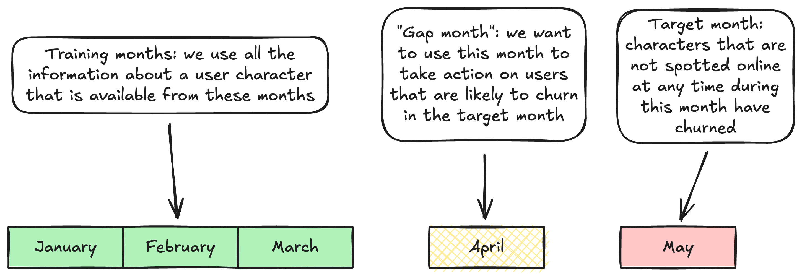
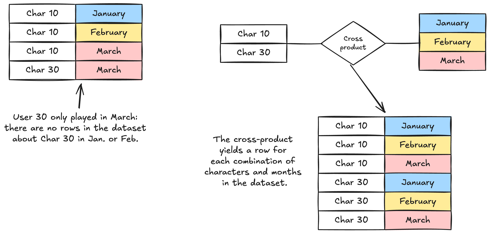
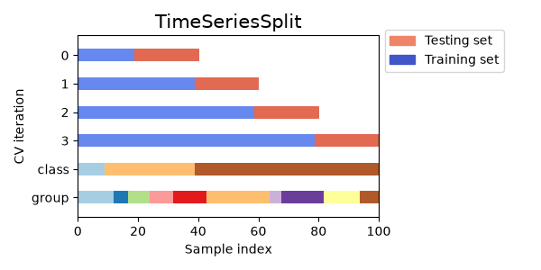
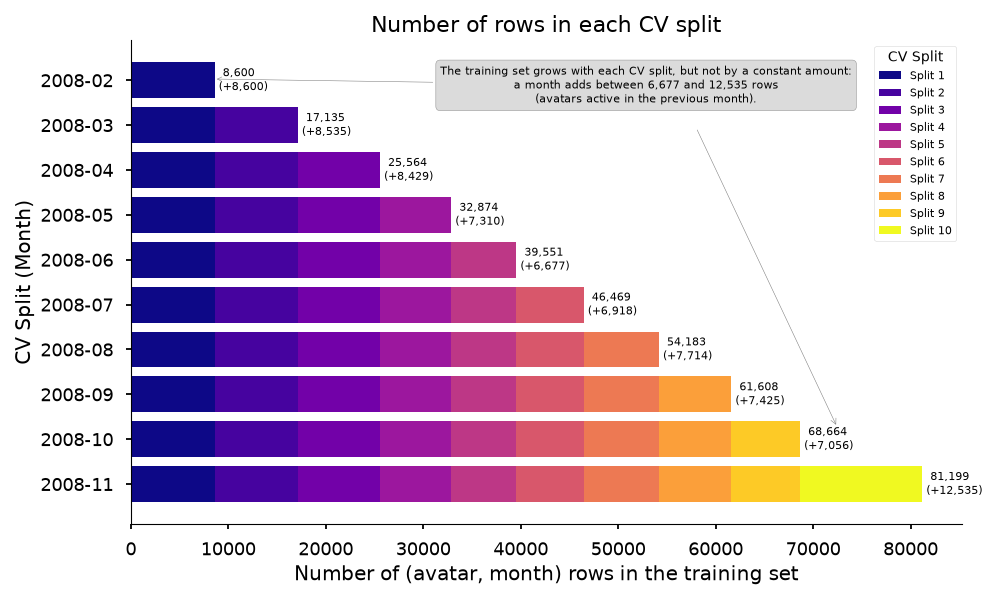




## What churn means here

Modeling user churn is a common application of machine learning models, though 
the definition of churn is typically business-specific. In general, by "user churn"
one refers to "a user that does not come back to the service for a certain length 
of time, if ever".

In the context of this example, churn refers to **those avatars that are not found
online for at least two consecutive months**: we consider those characters as 
users that stopped playing, and consequently suspended their subscription.  


::: {.callout-important}

In WoW, a single player may have multiple "player characters" or "avatars". The
information available in the dataset does not allow us to link a player to their
avatars, and as such we will treat **each avatar as an independent player**. 

This is reflected in how we model churn: as we do not have access to which player
is behind each avatar, we assume that **any churned avatar is a churned player**.

:::

As we do not have access to the actual subscription data, we assume that a player 
has suspended their subscription when they stop playing for **two consecutive 
months**. A single missing month is more likely a break than a cancellation, so
a character that skips a month and then comes back is not considered churned. 

For this post, we aggregate player behaviors at a monthly basis, and add a `has_played`
flag that tells us if a player has played at least once during each month. From it, 
we derive two columns:

- `churn`: the character has *churned as of this month*, i.e., `has_played` is `False` 
  both in this month and in the previous one.
- `churn_next`: the value of `churn` in the *following* month. This is the target 
  that we want to predict.


::: {.callout-important}

**Our objective**

Given a month (e.g., **June**), we want to use all the data up to the last day of the 
previous month (all months until **May** included) to predict whether a user will have 
churned as of **July** (i.e., their `has_played` flag will be `False` both in June and 
in July).

In other words, a row at month M means **"act during month M, using data up to the end of M-1, to predict absence in M and M+1."**


:::



::: {.callout-warning}
**Why we're predicting one month in the future**

Given the month of **June**, we may be tempted to use `churn` at this month as the
target. However, June's features are built from **May**, and `churn` for June _is 
only true if the character is absent in May_: any character that is active in May
is labeled as "not churned" by construction, and the model would learn that just by
looking at the missing values. This would produce overly optimistic results. 

Shifting the target to **July** avoids this problem: in _June_ we want to predict
whether a player is active in _July_ using data from and up to _May_.

:::

One caveat with this modeling strategy is that we are working with 
**historical data**, so we cannot actually apply said incentive and observe whether 
it has an impact like in a typical [A/B test](https://en.wikipedia.org/wiki/A/B_testing). 

### Building the churn dataset
We begin by adding two columns to the historical dataset: in the first we store 
each timestamp, truncated to have a monthly resolution; in the second we track the 
first month for each character. Additionally, we add a constant `has_played` column
that acts as our "player was seen" flag. 

We are interested in monthly snapshots, so the dataset is then reduced to select
only the unique (character, month) pairs. 

::: {.callout collapse="true"}
**Data preparation**

```{python}
#| echo: false
from add_churn import make_data
show(make_data)
```

```{python}
data = make_data(df)
```

:::

Since we want to predict the behavior a player will have over a single month, our
target variable will be grouped by "user-month" (e.g., `ID153_2026-12`). However, 
not all players will play at least once every month, so by relying exclusively 
on the historical data we would be missing samples; to get around this problem 
we generate a `char_month` dataset that contains all unique combinations of users
and months by executing the cross-product between the unique users and the range
of months. 



::: {.callout collapse="true"}

**Cross product**

The cross product between two sets (in this case, months and unique users) 
builds a new set where each element in the first set is paired with all elements
in the second set. 

```{python}
import polars as pl
df1 = pl.DataFrame({"col": [1,2,3]})
df2 = pl.DataFrame({"col": ["a","b"]})
df1.join(df2, how="cross")
```

:::

::: {.callout collapse="true"}
**Generate all unique combinations of users and months**

```{python}
#| echo: false
from add_churn import make_user_month
show(make_user_month)
```

```{python}
user_month = make_user_month(df)
user_month.collect()
```

:::

The grid extends three months past the end of the data to make sure the learner
does not crash with unseen data. 

Now that we have all the combinations (character, month), we can join back the 
prepared data to mark all the months in which each character was found online, 
and marking all others with `has_played=False`. 

Additionally, the resulting rows are filtered to remove all pairs (char, month) 
whose `month` precedes the character's first month. We should not have a row 
about a character's playtime in January if they started playing in August! 

Then we add the churn information. After sorting by month, `prev_played` is the 
`has_played` flag of the previous month for the same character (`False` for the 
first month), `churn` marks the characters absent in both months, and `churn_next` 
is `churn` shifted one month back within each character. The last observed month
has no "next month" to look at, so its `churn_next` is left empty, and so is that of
the three padding months. 


::: {.callout collapse="true"}
**Add the churn columns**
```{python}
#| echo: false
from add_churn import add_churn
show(add_churn)
```

```{python}
r = add_churn(user_month, data)
r.collect()
```

:::

Finally, we can put everything together in a single function that takes the 
historical data as input and returns a dataset with the churn indication as output. 
Rows without a target are dropped, since they can be used neither for training nor
for evaluation. Optionally, with `only_prev_active=True`, it also keeps only the rows 
of characters that played in the previous month. We come back to why below:

```{python}
#| echo: false
from add_churn import build_churn_dataset
show(build_churn_dataset)
```

```{python}
churn_data = build_churn_dataset(df, only_prev_active=True)
churn_data
```

This dataframe contains a row for each (character, month) in which the character
was active in the previous month, up until the second-to-last month of the dataset. 
In each row, `has_played` informs us of whether the character logged in at any time in
that month, and `churn_next` is the target that we want to predict on a monthly basis.

::: {.callout-note}
**Why only characters that were active in the previous month**

Features for month M are built from month M-1, so a character that was already absent in 
M-1 has no features at all. Such a character is also very likely to be labeled as 
churned: in the 2008 data, **75%** of the `churn_next=True` rows belong to characters that
were already absent in the previous month, and the trivial rule "absent last month" 
alone reaches a ROC AUC of 0.63. These rows have no features of their own, they 
make up most of the training set, and they are not characters we could still retain. 
We therefore only keep the rows where the character 
played in M-1, which leaves 81,199 of the 221,237 rows, and `churn_next=True` for 36.5% 
of them instead of 54.5%. In other words, the target is now "a character that was active in M-1 and is absent
in both M and M+1".
:::

## A splitter that respects time
Before starting with feature engineering and actually training the model, it's 
worth spending some time understanding the scenario we are in. 

The main factor that complicates this scenario is the fact that we are dealing
with sequential data points, which are therefore not independent of each other: 
*the position of a player at a time T is strongly correlated with their position
at time T+1*. 

### Why the default splitter does not fit
For this reason, we need to use a splitter that returns sequential splits. A 
common example of this is scikit-learn's
[TimeSeriesSplit](https://scikit-learn.org/stable/modules/generated/sklearn.model_selection.TimeSeriesSplit.html). `TimeSeriesSplit` works by splitting the entire dataset in a given number 
of splits; during cross-validation, at step K the splitter returns the first k
splits as the train split, and the k+1 split as the validation split. 

{fig-align="center"}

[Source](https://scikit-learn.org/stable/auto_examples/model_selection/plot_cv_indices.html#sphx-glr-auto-examples-model-selection-plot-cv-indices-py)

A downside of `TimeSeriesSplit` is that the splitter assumes uniformly distributed
samples, so that each singular split has the same size as the others. This is a 
problem for our scenario: our samples are (character, month) pairs, and the number
of characters in each month is never constant (in 2008, between about 6,700 and 12,500
rows per month): 

{fig-align="center"}

For this reason, we need to define a custom splitter that is aware of the constraints
we are working with. Given that we are working month-by-month, each split should
contain all the rows of a specific month (the characters that played in the previous
month, as explained above), and should be able to do so regardless of the fact that 
the number of characters changes.

There is a second constraint: the target of a row is the churn status of the 
*following* month, so it is only known one month later. If the training set included 
the rows of the month right before the test month, their targets would be computed 
from the activity in the test month. The splitter therefore leaves a one-month gap 
between the last training month and the test month.

This is what we implement here: 

```{python}
#| echo: false
import main

display(Markdown(
    f"The boundaries of the experiment are defined in `main.py`: split points go "
    f"from {main.MIN_DATE:%Y-%m-%d} to {main.MAX_DATE:%Y-%m-%d}, and each test "
    f"month is the one following its split point. The last test month is "
    f"the latest one whose target is fully observed."
))
```

```{python}
#| echo: false
from main import Splitter
show(Splitter)
```

Like all other scikit-learn splitters, our splitter is a generator that, given 
X and y (`user_month` and the target in our case), returns the indices of the 
samples that should be used in each split.

With the target defined and the splits under control, the next part builds the
features that describe each character's month: sessions first, then location.

