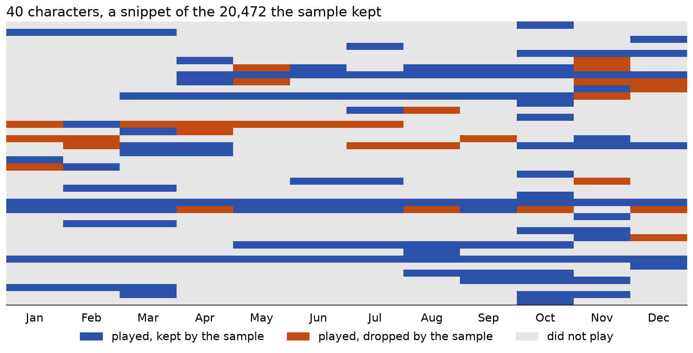




## From functions to a plan

Everything so far has been a function that takes a table and returns a table. A
skrub [Data Op](https://skrub-data.org/stable/data_ops.html) is what turns those
functions into a plan: a graph of nodes, each one either a step of the
pre-processing or the estimator at the end, with the hyperparameters declared
alongside so that they can be tuned together.

### Loading and downsampling the file

::: {.callout-tip collapse="true"}
**Loading and downsampling the file (click to expand)**

`load` parses the raw `.txt` heartbeat logs itself — parsing is a node of the
plan, not a separate pre-processing script — then downsamples the result to
reduce execution time. We need to be deliberate with how we sample the data:
rather than choosing a random subset of the values in the dataset, we need to
be careful to select a subset of characters and keep all the rows for those
characters. This ensures that we have reliable information about all the
characters.

```{python}
#| echo: false
from main import load
show(load)
```

:::

Sampling by character rather than by row is not a detail. A row-level sample
would punch holes in each character's monthly timeline, and a character with a
missing month looks exactly like a character who churned — the label would be
corrupted by the sampling. Keeping every row of a smaller set of characters
costs the same in compute and leaves the timelines intact.

### Why the sample is drawn by character

`load` parses first and samples second, and the sampling is one line of polars:
take the distinct `char` values, draw a fraction of them, keep every row whose
`char` is in that set. The default fraction is 0.1, and `--fraction 1` skips the
sampling entirely. The draw is seeded (`seed=42`), so the same characters come
back on every run — the model is not seeded, but the sample is.

The obvious alternative is to sample rows, and it is wrong here in a way that is
easy to miss, because the table it produces looks perfectly reasonable. It has
the same number of rows, the same columns, and no nulls. What it does not have is
intact timelines.

{fig-align="center"}

::: {.figure-caption}
A 10% sample of the rows, for 40 characters drawn at random from the 20,472 the
sample kept. Blue: the sample kept the month. Orange: the character played that
month, but the sample dropped it. Grey: the character did not play.
:::

The orange blocks are the problem. Each one is a month the character
demonstrably played, which the row sample threw away. Nothing about the
character changed — only how the sample was drawn.

The damage is not marginal. On the 2008 table — 10.8M heartbeats, 37,354
characters, 98,972 character-months — a 10% row sample keeps 20,472 characters
but loses **24% of the character-months those characters actually played**. Of
those characters, 13.9% end up with a hole in the middle of their timeline, 1.85
months wide on average. A character-level sample of the same size keeps 3,735
characters and loses nothing.

The holes matter because of how the label is built. `has_played` is derived from
presence in the table, so a dropped month is indistinguishable from a month the
character did not play. `churn` is "absent this month *and* the previous one", so
a dropped month can flip a row from negative to positive. Measured on the same
2008 data, **33% of the positives in the row-level sample are spurious** — 5,519
of 16,701 — while no true positive is lost. The corruption is one-directional: it
only invents churners, never hides them. Precision against the true labels is
0.67 and recall is 1.0.

That asymmetry is the reason the choice is not a matter of taste. A model trained
on the row sample would be learning to predict the sampling pattern as much as
the behaviour, and the pattern is not random with respect to the target: it fires
exactly on the rows where a character played a little. The character-level sample
costs the same to parse (the parse happens before the sample) and about the same
to fit (1.08M rows against 1.12M), and it buys complete timelines for fewer
characters instead of broken timelines for more.

The same `load` node runs on the held-out files, so the unseen evaluation samples
10% of the characters *of the unseen window*, not the characters chosen for
training. That is deliberate: the held-out run should not be able to recognise
which characters the model was fitted on.

### The hyperparameters

The hyperparameters of the pipeline are declared with skrub's `choose_*` functions.
They fall into three groups, and the grouping is what decides how they can be
searched:

- **Feature-table choices** change the arguments of `build_feature_table`, so
  each distinct combination is a separate entry in the skrub cache and a full
  rebuild of the feature table: the session gap, the zone-session gap, how many
  lags and diffs to add, whether to use location features, the Gini coefficient,
  and whether to add the monthly and class-level blocks.
- **Structural choices** only change what happens after the feature table is
  built, so a trial costs one refit per fold: whether to drop `char` and
  `month`, the vectorizer's cardinality threshold, its high-cardinality encoder,
  its null-drop fraction, and the regularisation of the linear model.
- **Capacity choices** are the model's own hyperparameters: the learning rate,
  the number of leaves, the minimum samples per leaf and the L2 penalty.

Mixing the first group into a model search would make most trials pay for a
feature-table rebuild they do not need, so the search runs in stages: a coarse
search over the feature choices on a 2% sample, then the structural choices with
a logistic regression, then the capacity choices with the gradient-boosted model.
`make_data_op(stage=...)` declares only the group a stage is meant to explore;
`frozen=` carries the winner of one stage into the next.

::: {.callout-tip}
**Full Data Op construction script**

```{python}
#| echo: false
from main import make_data_op
show(make_data_op)
```

:::

### The model and the encoder

The plan ends in a `TableVectorizer` followed by a
`HistGradientBoostingClassifier`. The vectorizer is what makes the mixed table
usable: it one-hot encodes the low-cardinality categorical columns (race, class,
most frequent zone, guilds) and leaves the numeric and duration columns alone.
The gradient-boosted tree model is a good fit for the rest — it handles nulls
natively, needs no scaling, and picks up the non-linearities in features like
level and session count without any manual binning.

The structural choices are searched with a logistic regression rather than the
gradient-boosted model. That is a statistical choice, not a speed one: with the
cache warm the feature table is free, so a trial costs 31 folds of vectorizer
plus model fitting either way. A linear model has far fewer effective
parameters, so the effect of dropping `char` or changing the cardinality
threshold is readable from the results instead of being buried in the variance
of a large tree ensemble. The linear branch needs a median imputer (the lag
columns are null for a character's first months) and skrub's `SquashingScaler`,
which is what `tabular_pipeline` uses for linear models.

`char` is exposed as a choice rather than dropped outright. It is an identifier,
not a feature, and left in the model can memorise per-character behaviour that
will not exist for a new character — but the search should show that rather than
have it asserted.

The scoring function is `roc_auc`. Accuracy would be misleading here, because
`churn_next` is true for only about 36.5% of the rows in the 2008 churn dataset
(81,199 rows over 10 months), so a model that always predicts "not churned"
already scores 0.64 accuracy while ranking nothing. AUC 0.5 is genuine chance,
and that is the number to compare against.

### Why only characters active in the previous month

The plan scores only characters that played in the previous month
(`only_prev_active=True`). The alternative — keeping every row, including
characters who were already absent — gives 221,237 rows in the 2008 data with
54.5% positives, against 81,199 rows and 36.5% positives for the restricted
version.

The restricted version is not just smaller, it is easier to score well on. 75% of
the old positive rows were already absent in the previous month, so the trivial
rule "absent last month" gets ROC AUC 0.63 without any model at all. On the same
test rows, a model trained on all rows scores 0.64 to 0.82 depending on the
month, against 0.82 to 0.90 when trained on active rows only. The rows with no
features do not make the problem easier — they pollute training. The cause is not
tested here, but the direction is consistent across every month.

There is also an operational argument: you can only retain characters who are
still around. Scoring characters who have already left produces a number that
looks like a churn rate but cannot be acted on.

## Running it

The data op is evaluated by passing a list of raw log file paths as input —
parsing them is itself one of the plan's nodes (see "Loading and downsampling the
file" above). Here we cross-validate it on 10% of the characters of the
historical (through October 2008) files:

```{python}
#| eval: false
data_op = make_data_op(load_fraction=0.1)
results = data_op.skb.cross_validate(environment=main.get_env("train"))
```

::: {.callout-note}
Only characters that played in the previous month are scored (see
`only_prev_active=True` above): the characters that were already absent have no
features and are not the ones that could be retained, and keeping them in the
training set lowers the scores on the characters that are still active.
:::

## Tuning

`random_search` wraps the plan in an Optuna study, persisted to
`wowah_churn_study.db` so that a run can be resumed. Two settings matter more
than the search space itself:

- `study_name`. Without it skrub generates a fresh UUID per call, which is why
  the database accumulated six studies before this was fixed.
- The search is **sequential**, and that is not a default to be raised. Parsing
  is a node of the plan and it spawns a process pool sized to the core count, so
  N parallel trials on a cold cache means N × cores processes. Measured at a 2%
  sample: 2 workers gave a 1.4× speedup and 4 gave 2.6×, but 8 drove a 24 GB
  machine into 40 GB of swap. The earlier `n_jobs=-1` runs are the same failure
  in a different guise — 72 failed trials, every one with `location_features=1`,
  all dying within nine seconds of starting.
- `timeout` is safe precisely because the search is sequential. skrub switches
  to Optuna's *threaded* parallelisation only when a timeout is set *and*
  `n_jobs > 1`, and threads deadlock against the parser's process pool. Note
  that a timeout counts wall-clock time, so a sleeping machine burns it;
  `n_iter` is the more predictable bound.

The search runs in three stages, each with its own study:

| Stage | Sample | Choices | Model | Trials | Cost/trial |
|---|---|---|---|---|---|
| `features` | 2% | the eight feature-table choices | HGB, defaults | 40 | 145 s |
| `gaps` | 10% | the three noisy feature choices, re-tested | logistic regression | 18 | 766 s |
| `structural` | 10% | the six post-feature-table choices | logistic regression | 40 | 342 s |
| `capacity` | 10% | the four model hyperparameters | HGB | 60 | 356 s |

The `gaps` stage exists because the Stage-1 ranking of `session_gap`,
`zone_session_gap` and `use_class_features` was inside the noise of a 2% sample:
the top ten trials spanned 0.852 to 0.860, and the gaps' margins were 0.001 to
0.002. Freezing a noise-level winner would propagate that noise into every later
stage, so those three are re-tested at 10% with the rest of the feature group
frozen. It is the most expensive stage per trial — 766 s, because each of the 18
combinations is a cold feature table — but it is also the smallest.

The winner of each stage is passed to the next through `frozen=`, so the later
stages search a smaller space around a configuration that is already known to be
reasonable. The final fit uses `stage="none"`, which declares no choice at all:
every knob takes the value found by the search, and the fitted plan contains no
unresolved choice.

### What the feature search found

40 trials at a 2% sample, mean ROC AUC over the 31 folds. The marginal effect of
each choice, averaged over the trials that used it:

| Choice | Value | Mean AUC | Trials |
|---|---|---|---|
| `lags` | none | 0.8402 | 7 |
| | 1 | 0.8553 | 6 |
| | 1–2 | 0.8535 | 8 |
| | 1–2–3 | **0.8569** | 19 |
| `use_monthly_features` | on | **0.8551** | 28 |
| | off | 0.8484 | 12 |
| `location_features` | on | **0.8543** | 29 |
| | off | 0.8499 | 11 |
| `add_gini` | off | **0.8548** | 24 |
| | on | 0.8518 | 5 |
| `session_gap` | 30 | 0.8503 | 9 |
| | 45 | **0.8546** | 18 |
| | 60 | 0.8529 | 13 |
| `use_class_features` | on | 0.8531 | 12 |
| | off | 0.8531 | 28 |

Three things are worth reading off this table. Lags matter a lot — dropping them
costs about 1.5 AUC points, the largest single effect in the search. The monthly
per-character block and the location block both help, by about 0.7 and 0.4 points
respectively. The Gini coefficient does not: it is the one feature block the
search says to leave off, which matches the earlier measurement that it adds
nothing over the rarity and zone-level columns while costing 1.4 s of the 1.6 s
location block.

The class-level block is exactly neutral, which is what a feature that is
constant within a class-month should look like: it cannot separate characters
that share a class.

One caveat on the sample. Zone rarity is `log(N / n_v)` over the characters in
the sample, so at 2% it is computed over roughly 750 characters instead of
37,000. The location block is therefore *noisier* in the search than it will be
in the final fit, which makes its 0.4-point advantage a lower bound rather than
an estimate.

One caveat is worth stating plainly: the search runs on the same folds that are
then reported, so the tuned score is optimistic. A clean comparison would need a
third window that neither the search nor the final evaluation touches.

### `char` is account age, not identity

The structural search turned up a result that looked wrong: dropping the `char`
column cost 0.019 AUC, the largest single effect anywhere in the project. The
obvious reading — the model memorises individual characters — is not what is
happening, for two reasons.

First, `char` is an `Int32`, and `TableVectorizer` passes numeric columns
through unchanged. The model sees a raw integer, not a one-hot identity, so it
cannot look up "character 66560 churns less".

Second, and this is the actual mechanism: character ids in this dataset are
assigned sequentially at creation, so the id is a near-perfect proxy for account
age. Spearman correlation between `char` and the character's first observed
month is **0.9986**. And account age is a strong churn predictor:

| Tenure (months) | Churn rate |
|---|---|
| 1 | 0.671 |
| 2 | 0.362 |
| 3 | 0.278 |
| 6 | 0.243 |
| 12 | 0.186 |

`first_month` was never in the feature table — it is in `add_lagged_features`'s
`exclude_cols` and was dropped before the vectorizer — so the model had no
explicit age signal and read it off the id instead.

Adding `tenure` as an explicit feature confirms the diagnosis. With tenure
present, on the same folds:

| Feature set | AUC |
|---|---|
| `char` kept | 0.8716 |
| `char` dropped | **0.8730** |

The 0.019 AUC that `char` appeared to carry was account age. Once tenure is
explicit, the id adds nothing and dropping it is marginally better. That is the
right outcome: an id is not a feature, and a model that leans on one is relying
on an artefact of how the dataset was numbered.

The next part looks at what the plan scores on data it has never seen, and at
what it costs to run.
