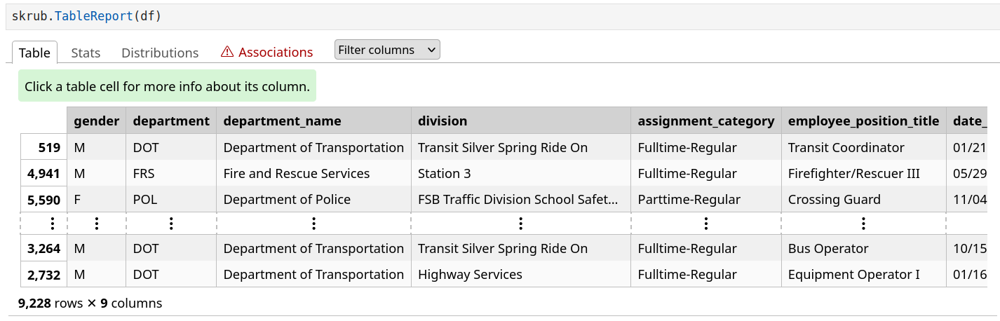
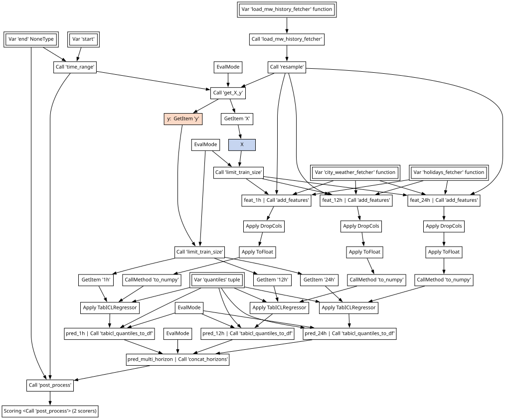
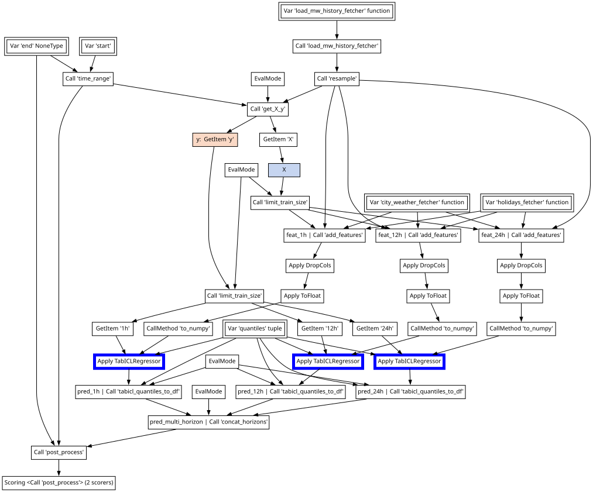
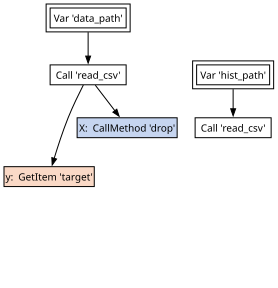
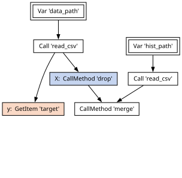
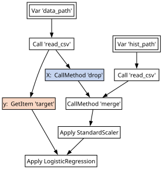
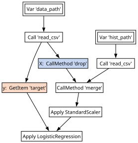

## `whoami`

- Product engineer at Probabl for the past month
- Before that, research engineer at Inria developing skrub


::: {.fragment}

Fun fact:

- Moved from Italy to the south of France and then to Paris because I don't like
the sea and the sun. 

:::


## Skrub {.smaller}

Machine learning on tabular data

{width="70%" style="margin-bottom: -1rem;" fig-align="center"}

{width="60%" style="margin-bottom: -1rem;" fig-align="center"}

::: {.fragment}
- [skrub-data.org](https://skrub-data.org)
- This talk: the [skrub DataOps](https://skrub-data.org/stable/data_ops.html) framework.
:::

## Roadmap for the presentation

1. skrub Data Ops: what are they? 
2. The dataset and the problem
3. The implementation and how Data Ops helped


::: {.fragment}

Libraries are even more important in the era of agents 🤖

:::


# Act 1: skrub Data Ops


## {.smaller}

:::: {.columns}

::: {.column width="44%"}

**Textbook ML**


<br>

$X \in \mathbb{R}^{n \times p},\ y \in \mathbb{R}^n$

$\hat{y} = f_{\hat{\theta}}(X)$

<br>

::: {.fragment}


```{=html}
<pre><code class="language-python">estimator = <span style="outline: 3px transparent; outline-offset: 1px;">TabICLRegressor()</span>

cross_validate(estimator, X, y)

estimator.fit(X_train, y_train)
estimator.predict(X_new)</code></pre>
```

:::


:::

::: {.column width="55%"}


::: {.fragment}

**Data-Science Practice**



:::


:::

::::

## {.smaller}

:::: {.columns}

::: {.column width="44%"}

**Textbook ML**

<br>

$X \in \mathbb{R}^{n \times p},\ y \in \mathbb{R}^n$

$\hat{y} = f_{\hat{\theta}}(X)$

<br>

```{=html}
<pre><code class="language-python">estimator = TabICLRegressor()

cross_validate(estimator, <span style="outline: 3px solid #2a52a8; outline-offset: 1px;">X</span>, <span style="outline: 3px solid #c04a10; outline-offset: 1px;">y</span>)

estimator.fit(X_train, y_train)
estimator.predict(X_new)</code></pre>
```
:::

::: {.column width="55%"}
**Data-Science Practice**


:::

::::

## {.smaller}

:::: {.columns}

::: {.column width="44%"}

**Textbook ML**

<br>

$X \in \mathbb{R}^{n \times p},\ y \in \mathbb{R}^n$

$\hat{y} = f_{\hat{\theta}}(X)$

<br>

```{=html}
<pre><code class="language-python">estimator = <span style="outline: 3px solid blue; outline-offset: 1px;">TabICLRegressor()</span>

cross_validate(estimator, X, y)

estimator.fit(X_train, y_train)
estimator.predict(X_new)</code></pre>
```
:::

::: {.column width="55%"}
**Data-Science Practice**


:::

::::


## 
To build a ML pipeline, we need to:

- [**preprocess the data**]{.emph}, perform [**feature engineering**]{.emph}, [**train a model**]{.emph} ... 
- with [**multi-source input**]{.emph} ... 
- so we need to [**learn a state**]{style="color: #1a5a8a; font-weight: bold;"}... 
- while we [**evaluate the predictive performance**]{style="color: #1a5a8a; font-weight: bold;"}... 
- as we avoid [**data leakage**]{style="color: #1a5a8a; font-weight: bold;"}... 

How do we deal with all that? 


## Data Ops: a basic example {.smaller auto-animate="true"}


::: {.columns}

::: {.column width=60%}


::: {.fragment .decl-pipeline}

Declare the pipeline

```{.python code-line-numbers="1-2|4|5-6|8|11-15"}
data_path = skrub.var("data_path")
data = data_path.skb.apply_func(pd.read_csv)

hist = skrub.var("hist_path").skb.apply_func(pd.read_csv)

X = data.drop(...).skb.mark_as_X()
y = data["target"].skb.mark_as_y()

X_join = X.merge(hist, on="id", how="left")

pred = X_join.skb.apply(
    StandardScaler(), cols=s.numeric()
).skb.apply(
    LogisticRegression(), y=y
)
```

:::


:::

::: {.column width=40%}


```{=html}
<div class="graph-reveal">





</div>
```


:::

:::


## Training and persisting the Data Ops {.smaller auto-animate="true"}


::: {.columns}

::: {.column width=60%}

Cross-validate

```{.python code-line-numbers="|2-5|"}
pred.skb.cross_validate(
    environment={
        "data_path": "historical_data.csv",
        "hist_path": "archive.csv"
    }
)
```

::: {.fragment}


Make a "learner" (object with `fit()` & `predict()`)

```{.python code-line-numbers="|2,7|3-6|8,13|9-12|"}
learner = pred.skb.make_learner(
).fit(
    environment={
        "data_path": "historical_data.csv",
        "hist_path": "archive.csv"
    }
)
learner.predict(
    environment={
        "data_path": "new_data.csv",
        "hist_path": "archive.csv"
    }
)
```


:::


:::

::: {.column width=40%}





:::

:::


## With Data Ops... {.smaller}

- Cross-validate without [**data leaks**]{style="color: #1a5a8a; font-weight: bold;"}: `fit()` on training
and `predict()` on unseen data. 
- Perform [**problem-specific data processing**]{.emph} and data wrangling with sample filtering, joins and aggregations, multiple inputs and dynamic arguments.
- [**Tune the architecture of the pipeline**]{style="color: #1a5a8a; font-weight: bold;"} with hyperparameter tuning and validation scores.
- Replay on [**new inputs**]{style="color: #1a5a8a; font-weight: bold;"}.
- [**Inspect**]{.emph} the pipeline step-by-step, [**read**]{.emph} the source code that generates a model.

# Act 2: Dataset and problem


## What are we here for?  {.smaller}
- **The dataset**: World of Warcraft Avatar history Dataset [^1]
  - World of Warcraft is a **subscription-based** online videogame.


::: {.fragment}


- **The problem**: Some players eventually stop playing, and thus stop paying
their subscription.
- On a given month, we want to enact some kind of **policy** on players at risk to stop 
them from leaving.

::: {.callout-important}

On month M, we want to predict `will_churn` for month M+1, based on features built
on data up to month M-1. 

`will_churn` is a **boolean flag** that is `True` if the player has not played on
month M and on month M+1. 

:::

:::

::: {.fragment}

- Our "unit of analysis" is a (player character, month) pair. 


:::

[^1]: [Source](https://web.cs.wpi.edu/~claypool/mmsys-dataset/2011/wow/)


## The game {.smaller}

::: {.columns}

::: {.column}

- World of Warcraft (WoW) is MMORPG released in 2004 by
Blizzard Entertainment. 
- Players create **character avatars** to explore the open game world
and perform various activities. 
- Players level up their characters to make them more powerful. 
- A single player may have **multiple avatars**. 

:::

::: {.column}


:::

:::


## Caveats

::: {.incremental}

- While we are interested in **players**, we have information only about their 
**avatars**. A player may stop playing with an avatar, but keep paying the subscription. 
- As this is past data, we cannot actually evaluate the effectiveness of whatever
measure we decide to implement, so we can only try to **predict player behavior**. 

:::

## World of Warcraft Avatar history {.smaller}

- ~35.6M timestamped "character is active" lines (**heartbeats**). 
- Time range: 2005-12-31 / 2009-01-10 in the 
**Taiwanese server**.

::: {.columns}

::: {.column}

**Folder structure**

```
WoWAH
├── 2006_01_03
│   ├── 2006-01-01
│   │   ├── 00-03-56.txt
│   │   ├── 00-13-43.txt
│   │   ├── 00-23-48.txt
│   │   ├── 00-33-48.txt
│   │   ├── ...
│   ├── 2006-01-02
│   ├── ...
├── 2006_04_06
├── ...
```


:::

::: {.column}

**Content of a single log file**

```{.lua}
Persistent_Storage = {
	[1] = "0, 12/31/05 23:59:46, 1,0, , 5, Orc, Warrior, Durotar, no, 0",
	[2] = "0, 12/31/05 23:59:46, 1,1, , 9, Orc, Shaman, Durotar, yes, 0",
	[3] = "0, 12/31/05 23:59:52, 2,2, , 13, Orc, Shaman, Durotar, no, 0",
	[4] = "0, 12/31/05 23:59:52, 2,3,0, 14, Orc, Warrior, Durotar, no, 0",
	[5] = "0, 12/31/05 23:59:52, 2,4, , 14, Orc, Shaman, Durotar, yes, 0",
	[6] = "0, 12/31/05 23:59:52, 2,5, , 16, Orc, Hunter, The Barrens, yes, 0",
	[7] = "0, 12/31/05 23:59:52, 2,6, , 18, Orc, Warlock, The Barrens, no, 0",
	[8] = "0, 12/31/05 23:59:52, 2,7, , 17, Orc, Hunter, Silverpine Forest, yes, 0",
...
```


:::

:::

## Time-aware cross-validation {.smaller auto-animate="true"}


## Time-aware cross-validation {.smaller auto-animate="true"}

::: {.columns}

::: {.column}

- Features and session aggregations must only use **data available at scoring time**
- Off-the-shelf `TimeSeriesSplit` assumes folds of **equal size**
- Here the number of (character, month) rows **changes every month** — folds are unbalanced by nature

:::

::: {.column}


:::

:::

## Time-aware cross-validation {.smaller auto-animate="true"}

- A splitter that uses **custom dataframe logic** is required to handle the situation.
- Custom splitters can use custom dataframe logic to select the samples
- Splitters plugged in `skb.mark_as_X(cv=Splitter())` are honored by 
`cross_validate`, `train_test_split`, randomized search, and scoring


```{.python code-line-numbers="|1-2|6-9|10-13|"}
class Splitter:
    def split(self, X, y=None):
        ...
        for split_point in ...:
            test_month = pl.Series([split_point]).dt.offset_by("1mo").first()
            train_idx = (
                X.with_row_index("idx")
                .filter(pl.col("month") <= split_point)["idx"]
            )
            test_idx = (
                X.with_row_index("idx")
                .filter(pl.col("month") == test_month)["idx"]
            )
```

## Feature engineering: defining sessions {.smaller}

We want to model player behavior by measuring statistics about **playing sessions**. 

- How many sessions does a player have in a month?
- How long do the sessions last? 
- Does the player have a consistent schedule?

`skrub.SessionEncoder` turns heartbeats into **sessions**:

## Choosing the session gap {.smaller}

::: {.columns}

::: {.column width="62%"}


:::

::: {.column width="38%"}

Depending on the session gap, the same heartbeats can lead to different sessions:

- **15 min** → 3 sessions
- **30 min** → 2 sessions
- **60 min** → 1 session


::: {.callout-important}

Every feature down the line depends on the session gap. 

:::

:::

:::

## From sessions to one row {.smaller}

::: {.columns}

::: {.column width="47%"}

**Nine sessions, March**

::: {style="font-size: 0.72em;"}

| session | start | end | duration |
|:--:|-----------|-----------|------|
| 0 | 03-01 09:08 | 03-01 11:38 | 2h 30m |
| 1 | 03-01 22:28 | 03-01 22:28 | 1m |
| 2 | 03-05 21:41 | 03-05 22:21 | 39m 45s |
| 3 | 03-08 10:40 | 03-08 11:31 | 50m 14s |
| 4 | 03-09 08:41 | 03-09 11:31 | 2h 50m |
| 5 | 03-09 12:11 | 03-09 13:41 | 1h 30m |
| 6 | 03-14 21:51 | 03-14 22:21 | 30m 01s |
| 7 | 03-14 23:11 | 03-14 23:51 | 39m 44s |
| 8 | 03-15 11:11 | 03-15 11:41 | 29m 57s |

:::

:::

::: {.column width="53%"}

**→ one row per (char, month)**

::: {style="font-size: 0.72em;"}

| feature | value |
|----------------------------------|-----------|
| `monthly_num_sessions` | 9 |
| `monthly_total_session_duration` | 10h 01m |
| `monthly_avg_session_duration` | 1h 07m |
| `monthly_std_session_duration` | 58m 02s |
| `monthly_avg_session_start` | 02:20 |
| `monthly_avg_session_end` | 03:27 |

:::

:::

:::

## Feature engineering {.smaller}

- Monthly aggregates 
  - Statistics by class, race, overall playerbase...
- Location-based features
  - Zone rarity, where players spend their time
- Lagged features 
- `skrub.TableVectorizer` to encode 


## Model selection

- First pass with `LogisticRegression` to decide the architecture of the pipeline
- Secont pass with `HistGradientBoostingClassifier` (HGBC)
- Month-by-month time-aware CV
- Data Ops are used to tune **hyperparameters** and **architectural decisions**


# Act 3: The implementation


## What is this section for?

- The implementation revealed a number of **pain points** that Data Ops simplified.
- We focus on some of the main issues without discussing the entire implementation.


## Pain point 1 - Data preparation is part of the pipeline 1/2 {.smaller}

::: {.incremental}
- Data is not clean: heartbeats are in **text files** scattered over **hundreds of folders**
rather than in a more manageable format. 
- Boilerplate code and pre-processing scripts are **brittle** and **prone to errors**.
- Once transformations are learned, they need to be **replayed on new data**, 
**including the pre-processing**.

:::

## Pain point 1 - Data preparation is part of the pipeline 2/2 {.smaller}


::: {.columns}

::: {.column width="60%"}

**Building the pipeline**

```{.python code-line-numbers="|2|3|5-7|9-10|12-13|14|15|"}
def make_data_op():
    raw_files = skrub.var("raw_files")
    historical_data = raw_files.skb.apply_func(load)

    user_month = historical_data.skb.apply_func(
        build_churn_dataset
    ).skb.set_name("query")
    
    X = user_month["char", "month"].skb.mark_as_X(...)
    y = user_month["churn_next"].skb.mark_as_y()

    feature_table = historical_data.skb.apply_func(build_feature_table)
    all_features = X.skb.apply_func(add_features, feature_table)
    encoded = all_features.skb.apply(skrub.TableVectorizer())
    data_op = encoded.skb.apply(HGBC(), y=y)
    return data_op

```

:::

::: {.column width="40%"}


::: {.fragment}


**Exporting the learner**

```{.python code-line-numbers="|4,8|5-7|10,14|11-13|"}
...
data_op, X = make_data_op()
learner = data_op.skb.make_learner()
learner.fit(
    environment={
        "raw_files": "historical_data/"
    }
)

predictions = learner.predict(
    environment={
        "raw_files": "latest_month/"
    }
)
...
```

:::

:::

:::


## Pain point 2 - Hyperparameter tuning 1/2 {.smaller auto-animate="true"}

Tuning hyperparameters in scikit-learn can be complex...

```{.python}
pipe = Pipeline([("dim_reduction", PCA()), ("regressor", Ridge())])
grid = [
    {
        "dim_reduction": [PCA()],
        "dim_reduction__n_components": [10, 20, 30],
        "regressor": [Ridge()],
        "regressor__alpha": loguniform(0.1, 10.0),
    },
    {
        "dim_reduction": [SelectKBest()],
        "dim_reduction__k": [10, 20, 30],
        "regressor": [Ridge()],
        "regressor__alpha": loguniform(0.1, 10.0),
    },
    {
        "dim_reduction": [PCA()],
        "dim_reduction__n_components": [10, 20, 30],
        "regressor": [RandomForestRegressor()],
        "regressor__n_estimators": loguniform(20, 200),
    },
    {
        "dim_reduction": [SelectKBest()],
        "dim_reduction__k": [10, 20, 30],
        "regressor": [RandomForestRegressor()],
        "regressor__n_estimators": loguniform(20, 200),
    },
]
```
## Pain point 2 - Hyperparameter tuning 2/2 {.smaller} 

With Data Ops, you can [**define the search space with the estimator**]{.emph}:

```{.python code-line-numbers="|2,6,7|4,5|"}
dim_reduction = X.skb.apply(
    skrub.choose_from(
        {
            "PCA": PCA(n_components=skrub.choose_int(10, 30)),
            "SelectKBest": SelectKBest(k=skrub.choose_int(10, 30))
        }, name="dim_reduction"
    )
)
```


::: {.fragment}

Choices can be made about [**any part of the pipeline**]{.emph}:

```{.python code-line-numbers="|6"}
df = pd.DataFrame({
    "region":  ["North", "North", "South", "South", "East", "East", "North", "South"],
    "revenue": [100.0, 225.0, 70.0, 180.0, 90.0, 300.0, 50.0, 80.0],
})
do = skrub.var("data", df)
do.groupby("region")["revenue"].agg(skrub.choose_from(["mean", "sum", "max"]))

```

:::


## Pain point 3 - Treating pipeline decisions like hyperparameters 1/3 {.smaller auto-animate="true"}

::: {.incremental}

- Model choices are not limited to model hyperparameters: `session_gap` (30/45/60 min), include location features?, which lags?
- These are [**data pipeline decisions**]{.emph}, with big performance and runtime impact
- Pipeline decisions [**modify the pipeline itself**]{.emph}, and regular hyperparameter tuning does not work

:::

## Pain point 3 - Treating pipeline decisions like hyperparameters 2/3 {.smaller auto-animate="true"}
```{=html}
<ul style="font-size: 0.8em;">
<li>Replace any value with a choice:</li>
</ul>
<pre style="font-size: 0.55em; background-color: #f5f5f5; padding: 0.6em 1em; margin: 0.8em 0;"><code style="background-color: inherit;">X_enc = X.skb.apply_func(build_feature_table,
<span style="color: #c00; background-color: #fff0f0;">-    session_gap=<span style="background-color: #f9a0a0;">30</span>,</span>
<span style="color: #080; background-color: #f0fff0;">+    session_gap=<span style="background-color: #9be99b;">skrub.choose_from([30, 45, 60])</span>,</span>
 )
 pred = X_enc.skb.apply(HGBC(), y=y)</code></pre>
<ul style="font-size: 0.8em;">
<li>Tune data pipeline decisions, not only hyperparameters</li>
</ul>
<pre style="font-size: 0.55em; background-color: #f5f5f5; padding: 0.6em 1em; margin: 0.8em 0;"><code style="background-color: inherit;">X_enc = X.skb.apply_func(build_feature_table,
<span style="color: #080; background-color: #f0fff0;">+    insert_additional_features=<span style="background-color: #9be99b;">skrub.choose_bool()</span>,</span>
 )
 pred = X_enc.skb.apply(HGBC(), y=y)</code></pre>
```


## Pain point 3 - Treating pipeline decisions like hyperparameters 3/3 {.smaller auto-animate="true"}

::: {.incremental}

- **With DataOps** choices can be dropped inline, where the value is used — `choose_from`, `choose_bool`, `choose_float(log=True)`
- One call to `skb.make_randomized_search(backend="optuna", ...)` turns the whole DAG into a search 
- skrub integrates and **calls Optuna** directly
- Then, use the *Optuna dashboard* to navigate the results

:::

## Pain point 4 - Debugging and inspecting a pipeline 1/2
- Inspecting a regular pipeline is complex and requires **programmatic access**
- The result of intermediate steps is hard to access without re-executing everything
- Once deployed, it is hard to maintain a trained model ("why was this step needed?", 
"where is the source code?")

## Pain point 4 - Debugging and inspecting a pipeline 2/2

[Data Ops execution report](reports/execution_report/index.html){target="_blank"}

- Data Ops reports provide rich information about each node
- The source code used to generate a Data Op is bundled with it
- When a preview or environment is provided, intermediate results can be shown


## Pain point 5 — The Need for Caching 1/2 {.smaller}

- Parsing is a **node of the plan**, rather than a separate pre-processing step
- Cross-validation **re-evaluates** the entire plan => parsing is repeated in each fold
- We need to choose between **keeping parsing in the pipeline** and **quick iteration**

::: {.fragment}

::: {.callout-warning}

Each CV fold parses all the heartbeats twice: **68 s** per parse, **~71 minutes**
of parsing alone, before any feature engineering or model fitting.

:::

::: {.callout-important}

This is exactly what we want caching for! 

:::


:::

## Pain point 5 — The Need for Caching 2/2 {.smaller}

- Data Ops can be **cached**! 
- Joblib caching can be used to save time across folds.

```python
CACHE_DIR = Path(__file__).parent / ".skrub_cache"
skrub.set_config(cache=str(CACHE_DIR))
```

| | wall time | `parse_files` calls |
|---|---:|---:|
| cache off | ~75 min (extrapolated) | 63 |
| cache cold | 289 s | 1 |
| cache warm | 213 s | 0 |

In this case, ~15x speedup. 

# Conclusions

## Main takeaways {.smaller}

::: {.columns}

::: {.column}

::: {.incremental}
- skrub is a cool package 😎
- Pre-processing should not be seen as separate from building your predictive pipeline 🔧
- Data Ops mitigate and address issues throughout the development of the pipeline 🚒
- Good libraries and abstractions are even more important in the age of agents 🤖

:::

:::

::: {.column}


:::

:::

