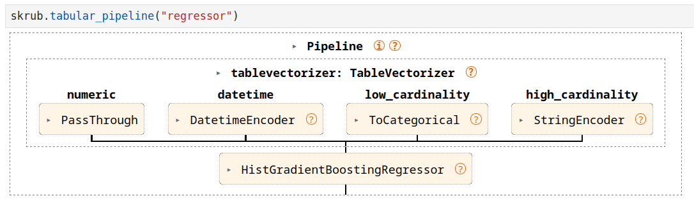
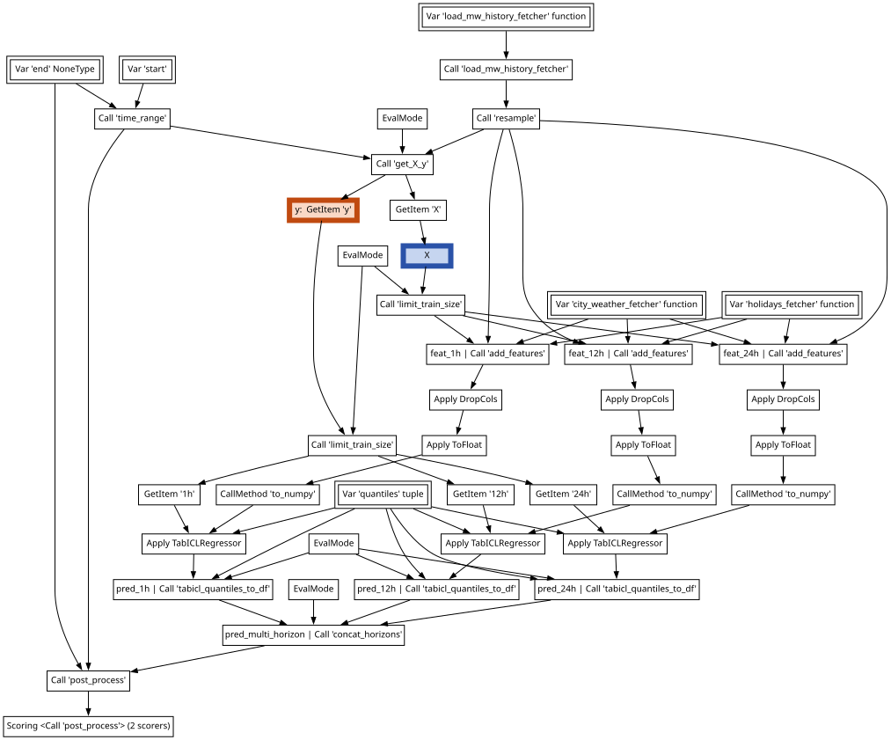
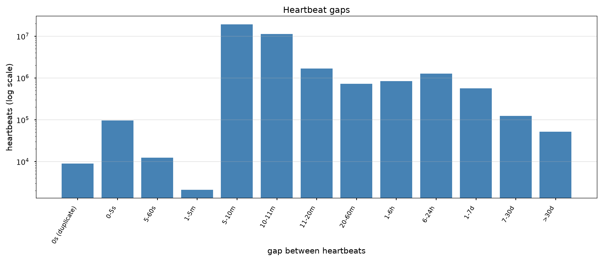
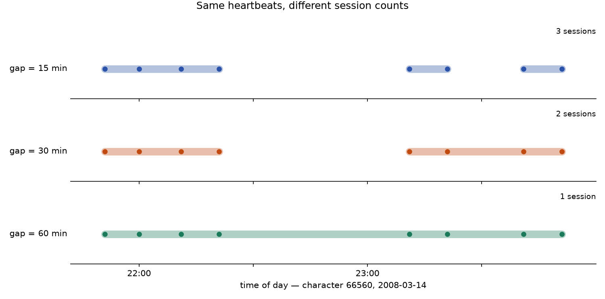
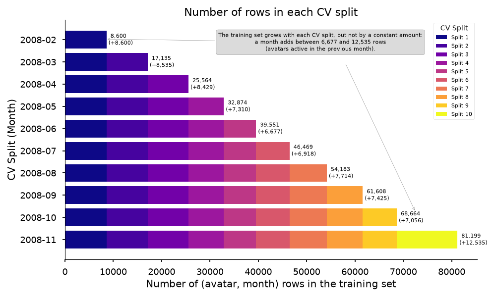

## Skrub {.smaller}

Machine learning on tabular data

{width="70%" style="margin-bottom: -1rem;"}

{width="60%" style="margin-bottom: -1rem;"}

::: {.incremental}
- [skrub-data.org](https://skrub-data.org)
- This talk: the [skrub DataOps](https://skrub-data.org/stable/data_ops.html) framework.
:::

# Act 1: skrub Data Ops

## {.smaller}

:::: {.columns}

::: {.column width="44%"}

**Textbook ML**


<br>

$X \in \mathbb{R}^{n \times p},\ y \in \mathbb{R}^n$

$\hat{y} = f_{\hat{\theta}}(X)$

<br>

::: {.fragment}


```{=html}
<pre><code class="language-python">estimator = <span style="outline: 3px transparent; outline-offset: 1px;">TabICLRegressor()</span>

cross_validate(estimator, X, y)

estimator.fit(X_train, y_train)
estimator.predict(X_new)</code></pre>
```

:::


:::

::: {.column width="55%"}


::: {.fragment}

**Data-Science Practice**


:::


:::

::::

## {.smaller}

:::: {.columns}

::: {.column width="44%"}

**Textbook ML**

<br>

$X \in \mathbb{R}^{n \times p},\ y \in \mathbb{R}^n$

$\hat{y} = f_{\hat{\theta}}(X)$

<br>

```{=html}
<pre><code class="language-python">estimator = TabICLRegressor()

cross_validate(estimator, <span style="outline: 3px solid #2a52a8; outline-offset: 1px;">X</span>, <span style="outline: 3px solid #c04a10; outline-offset: 1px;">y</span>)

estimator.fit(X_train, y_train)
estimator.predict(X_new)</code></pre>
```
:::

::: {.column width="55%"}
**Data-Science Practice**


:::

::::

## {.smaller}

:::: {.columns}

::: {.column width="44%"}

**Textbook ML**

<br>

$X \in \mathbb{R}^{n \times p},\ y \in \mathbb{R}^n$

$\hat{y} = f_{\hat{\theta}}(X)$

<br>

```{=html}
<pre><code class="language-python">estimator = <span style="outline: 3px solid blue; outline-offset: 1px;">TabICLRegressor()</span>

cross_validate(estimator, X, y)

estimator.fit(X_train, y_train)
estimator.predict(X_new)</code></pre>
```
:::

::: {.column width="55%"}
**Data-Science Practice**


:::

::::


## 
To build a ML pipeline, we need to:

- preprocess the data, perform feature engineering, train a model ... 
- so we need to [**learn a state**]{style="color: #1a5a8a; font-weight: bold;"}... 
- while we [**evaluate the predictive performance**]{style="color: #1a5a8a; font-weight: bold;"}... 
- as we avoid [**data leakage**]{style="color: #1a5a8a; font-weight: bold;"}... 
- with multi-source input ... 

How do we deal with that? 

## With Data Ops... {.smaller}

- Cross-validate without [**data leaks**]{style="color: #1a5a8a; font-weight: bold;"}: `fit()` on training
and `predict()` on unseen data. 
- [**Tune choices**]{style="color: #1a5a8a; font-weight: bold;"} with hyperparameter tuning and validation scores.
- Replay on [**new inputs**]{style="color: #1a5a8a; font-weight: bold;"}.
- **Arbitrary data processing** and data wrangling with sample filtering, joins and aggregations, multiple inputs and dynamic arguments.
- **Inspect** the pipeline step-by-step, **persist** the source code that generates a model.

## Basic example {.smaller auto-animate="true"}


::: {.columns}

::: {.column width=60%}


::: {.fragment fragment-index=1}

Declare the pipeline

```{.python code-line-numbers="|1-2|3|4-5|6|7-9|"}
data_path = skrub.var("data_path")
data = data_path.skb.apply_func(pd.read_csv)
hist = skrub.var("hist_path").skb.apply_func(pd.read_csv)
X = data.drop(columns="target", errors="ignore").skb.mark_as_X()
y = data["target"].skb.mark_as_y()
X_join = X.merge(hist, on="id", how="left")
pred = X_join.skb.apply(
    StandardScaler()
).skb.apply(LogisticRegression(), y=y)
```


:::


::: {.fragment}

Cross-validate

```{.python code-line-numbers="|2|"}
pred.skb.cross_validate(
    environment={"data_path": "historical_data.csv", "hist_path": "archive.csv"}
)
```

:::


::: {.fragment}


Make a "learner" (object with `fit()` & `predict()`)

```{.python code-line-numbers="|2|3|5|6|"}
learner = pred.skb.make_learner(
).fit(
    environment={"data_path": "historical_data.csv", "hist_path": "archive.csv"}
)
learner.predict(
    environment={"data_path": "new_data.csv", "hist_path": "archive.csv"}
)
```


:::


:::

::: {.column width=40%}


::: {.fragment fragment-index=2}


:::


:::

:::


# Act 2: Dataset and problem


## What are we here for?  {.smaller}
- **The dataset**: World of Warcraft Avatar history Dataset [^1]
  - World of Warcraft is a **subscription-based** online videogame.
  - The dataset collects player activity over 2005-2009.


::: {.fragment}


- **The problem**: Some players eventually stop playing, and thus stop paying
their subscription.

::: {.callout-important}

On month M, we want to predict `will_churn` for month M+1, based on features built
on data up to month M-1. 

`will_churn` is a **boolean flag** that is `True` if the player has not played on
month M and on month M+1. 

:::

:::

::: {.fragment}

- Our "unit of analysis" is a (player character, month) pair. 
- On month M, we want to enact some kind of policy on players at risk to stop 
them from leaving.


:::

[^1]: [Source](https://web.cs.wpi.edu/~claypool/mmsys-dataset/2011/wow/)


## The game {.smaller}

::: {.columns}

::: {.column}

- World of Warcraft (WoW) is MMORPG released in 2004 by
Blizzard Entertainment. 
- Players create **character avatars** to navigate the open game world
and perform various activities. 
- Players level up their characters to make them more powerful. 
- A single player may have **multiple avatars**. 

:::

::: {.column}


:::

:::


## World of Warcraft Avatar history {.smaller}

- ~35.6M timestamped "character is active" lines (**heartbeats**). 
- Time range: 2005-12-31 / 2009-01-10 in the 
**Taiwanese server**.
- Two expansions are included in the range:
  - The Burning Crusade (April 2007)
  - Wrath of the Lich King (November 2008).  
- Expansions add content and lead to an influx of new and old players. 


## Raw data structure {.smaller}


::: {.columns}

::: {.column}

**Folder structure**

```
WoWAH
├── 2006_01_03
│   ├── 2006-01-01
│   │   ├── 00-03-56.txt
│   │   ├── 00-13-43.txt
│   │   ├── 00-23-48.txt
│   │   ├── 00-33-48.txt
│   │   ├── ...
│   ├── 2006-01-02
│   ├── ...
├── 2006_04_06
├── ...
```


:::

::: {.column}

**Content of a single log file**

```
# head WoWAH/2006_01_03/2006-01-01/00-03-56.txt 
Persistent_Storage = {
	[1] = "0, 12/31/05 23:59:46, 1,0, , 5, Orc, Warrior, Durotar, no, 0",
	[2] = "0, 12/31/05 23:59:46, 1,1, , 9, Orc, Shaman, Durotar, yes, 0",
	[3] = "0, 12/31/05 23:59:52, 2,2, , 13, Orc, Shaman, Durotar, no, 0",
	[4] = "0, 12/31/05 23:59:52, 2,3,0, 14, Orc, Warrior, Durotar, no, 0",
	[5] = "0, 12/31/05 23:59:52, 2,4, , 14, Orc, Shaman, Durotar, yes, 0",
	[6] = "0, 12/31/05 23:59:52, 2,5, , 16, Orc, Hunter, The Barrens, yes, 0",
	[7] = "0, 12/31/05 23:59:52, 2,6, , 18, Orc, Warlock, The Barrens, no, 0",
	[8] = "0, 12/31/05 23:59:52, 2,7, , 17, Orc, Hunter, Silverpine Forest, yes, 0",
...
```


:::

:::

## The dataset: gap between heartbeats {.smaller}


## Feature engineering: defining sessions {.smaller}

`skrub.SessionEncoder` turns heartbeats into **sessions**:

- A heartbeat joins the current session if it arrives **at most `session_gap`**
minutes after the previous heartbeat of the same character.
- It only **adds a column** (`timestamp_session_id`): the rows and their order are
unchanged, so it can be applied inside the feature function.
- Sessions are then reduced to monthly features: number of sessions, total / mean /
std of their duration, mean start and end time.

::: {.fragment}

- **The gap is a decision**, not a constant: `session_gap` is a tuned choice,
`choose_from([30, 60, 15])`, and the encoder is **refit for every month**.
- **It is run twice**: once per character, and once per `(char, zone)` to give the
location features the time spent in each zone.

:::

## From heartbeats to sessions {.smaller}

::: {.columns}

::: {.column width="52%"}

**One character, one night (gap = 30 min)**

| beat | gap to previous | session |
|--------|-----------|:-----:|
| 21:51:06 | — | **0** |
| 22:00:50 | 9m 44s | 0 |
| 22:11:23 | 10m 33s | 0 |
| 22:21:07 | 9m 44s | 0 |
| 23:11:21 | **50m 14s** | **1** |
| 23:21:04 | 9m 43s | 1 |
| 23:41:22 | 20m 18s | 1 |
| 23:51:05 | 9m 43s | 1 |

:::

::: {.column width="48%"}

::: {.fragment}

- A gap **larger than `session_gap`** is the only thing that opens a new session.
- The encoder **adds one column** and leaves every row and its order untouched.
- The gap is a tuned choice (15 / 30 / 60), so this boundary is a **pipeline
hyperparameter**, not a constant.

:::

:::

:::

::: {.notes}
This is char 66560 on 2008-03-14, straight from the parquet. Note the 20m 18s gap:
it is smaller than 30 minutes, so it stays inside session 1, while the 50m 14s gap
splits. At 15 minutes the night would be 3 sessions; at 60 minutes, 1 — the same
night as the previous slide.
:::

## Same beats, different sessions {.smaller}

::: {.columns}

::: {.column width="62%"}



:::

::: {.column width="38%"}

One night of one character, the same heartbeats, three gaps:

- **15 min** → 3 sessions
- **30 min** → 2 sessions
- **60 min** → 1 session

The gap is where the pipeline's **definition of "playing"** is set: every session
feature downstream changes with it.

:::

:::

## From sessions to one row {.smaller}

::: {.columns}

::: {.column width="47%"}

**Nine sessions, March**

::: {style="font-size: 0.72em;"}

| session | start | end | duration |
|:--:|-----------|-----------|------|
| 0 | 03-01 09:08 | 03-01 11:38 | 2h 30m |
| 1 | 03-01 22:28 | 03-01 22:28 | 1m |
| 2 | 03-05 21:41 | 03-05 22:21 | 39m 45s |
| 3 | 03-08 10:40 | 03-08 11:31 | 50m 14s |
| 4 | 03-09 08:41 | 03-09 11:31 | 2h 50m |
| 5 | 03-09 12:11 | 03-09 13:41 | 1h 30m |
| 6 | 03-14 21:51 | 03-14 22:21 | 30m 01s |
| 7 | 03-14 23:11 | 03-14 23:51 | 39m 44s |
| 8 | 03-15 11:11 | 03-15 11:41 | 29m 57s |

:::

:::

::: {.column width="53%"}

**→ one row per (char, month)**

::: {style="font-size: 0.72em;"}

| feature | value |
|----------------------------------|-----------|
| `monthly_num_sessions` | 9 |
| `monthly_total_session_duration` | 10h 01m |
| `monthly_avg_session_duration` | 1h 07m |
| `monthly_std_session_duration` | 58m 02s |
| `monthly_avg_session_start` | 02:20 |
| `monthly_avg_session_end` | 03:27 |

:::

::: {.fragment}

Session 1 is a **single heartbeat**: `get_session_duration` gives it 1 minute, so
"logged in briefly" ≠ "never logged in".

:::

:::

:::

::: {.notes}
`add_session_features` is the group_by that turns the left table into the right one;
the row is keyed (char, month) and the March sessions feed April's row. Two details
worth saying out loud: the std is computed on microseconds because polars cannot take
the std of a Duration column, and `monthly_avg_session_start` / `_end` are means of
timestamps across the whole month, so they only carry a time-of-day signal, not a
date. The number of sessions, the total and the average duration carry most of the
signal.
:::

## Feature engineering {.smaller}

- Monthly aggregates 
  - Statistics by class, race, overall playerbase...
- Location-based features
  - Zone rarity, where players spend their time
- Lagged features 
- `skrub.TableVectorizer` to encode 

More detail about feature engineering and model selection is available in the full technical report. 

## Model selection

- `HistGradientBoostingClassifier` (HGBC) as the evaluation model
- Month-by-month time-aware CV
- Data Ops are used to tune **hyperparameters** and **architectural decisions**


## Caveats
- While we are interested in **players**, we have information only about their 
**avatars**. A player may stop playing with an avatar, but keep paying the subscription. 
- As this is past data, we cannot actually evaluate the effectiveness of whatever
measure we decide to implement, so we can only try to **predict player behavior**. 


# Act 3: The implementation

## What is this section for?

- The implementation revealed a number of **pain points** that Data Ops simplified.
- We focus on some of the main issues without discussing the entire implementation here.


## Pain point 1 - Data preparation is part of the pipeline {.smaller}

- Data is not clean: heartbeats are in **text files** scattered over **hundreds of folders**
rather than in a more manageable format. 
- Once transformations are learned, they need to be **replayed on new data**. 
- Boilerplate code and pre-processing scripts are **brittle** and **prone to errors**.


## Pain point 1 - Data preparation is part of the pipeline {.smaller}


::: {.columns}

::: {.column width="60%"}

**Building the pipeline**

```{.python code-line-numbers="|2|3|5-7|9-10|12-13|14|15|"}
def make_data_op():
    raw_files = skrub.var("raw_files")
    historical_data = raw_files.skb.apply_func(load)

    user_month_has_played = historical_data.skb.apply_func(
        build_churn_dataset
    ).skb.set_name("query")
    
    X = user_month_has_played["char", "month"].skb.mark_as_X(...)
    y = user_month_has_played["churn_next"].skb.mark_as_y()

    feature_table = historical_data.skb.apply_func(build_feature_table)
    encoded = feature_table.skb.apply(skrub.TableVectorizer())
    data_op = encoded.skb.apply(HGBC(), y=y)
    return data_op

```

:::

::: {.column width="40%"}


::: {.fragment}


**Exporting the learner**

```{.python}
...
data_op, X = make_data_op()
learner = data_op.skb.make_learner()
learner.fit(environment={"raw_files": "historical_data/"})

predictions = learner.predict(environment={"raw_files": "latest_month/"})
...
```

:::

:::

:::

## Pain point 2 — Time-aware cross-validation {.smaller auto-animate="true"}


## Pain point 2 — Time-aware cross-validation {.smaller auto-animate="true"}

::: {.columns}

::: {.column}

- Features and session aggregations must only use **data available at scoring time**
- Off-the-shelf `TimeSeriesSplit` assumes folds of **equal size**
- Here the number of (character, month) rows **changes every month** — folds are unbalanced by nature

:::

::: {.column}


:::

:::

## Pain point 2 — Time-aware cross-validation {.smaller auto-animate="true"}


::: {.columns}

::: {.column width=45%}


- Data Ops natively support  **custom splitters** for splitting data in the DAG.
- Custom splitters can use custom dataframe logic to select the samples
- Splitters plugged in `skb.mark_as_X(cv=Splitter())` are honored by 
`cross_validate`, `train_test_split`, randomized search, and scoring

:::

::: {.column width=55%}


```{.python}
class Splitter:
    def split(self, X, y=None):
        ...
        for split_point in ...:
            test_month = pl.Series([split_point]).dt.offset_by("1mo").first()
            train_idx = (
                X.with_row_index("idx")
                .filter(pl.col("month") <= split_point)["idx"]
            )
            test_idx = (
                X.with_row_index("idx")
                .filter(pl.col("month") == test_month)["idx"]
            )
```

:::

:::


## Pain point 3 — Tuning the architecture of the pipeline, not just model knobs {.smaller auto-animate="true"}

- Model choices are not limited to model hyperparameters: `session_gap` (15/30/60 min), include location features?, which lags?
- These are **data pipeline decisions**, with big performance and runtime impact
- Pipeline decisions **modify the pipeline itself**, and regular hyperparameter tuning does not work


## Pain point 3 — Tuning the architecture of the pipeline, not just model knobs {.smaller auto-animate="true"}
- **With DataOps** choices can be dropped inline, where the value is used — `choose_from`, `choose_bool`, `choose_float(log=True)`
- One call to `skb.make_randomized_search(backend="optuna", ...)` turns the whole DAG into a search 

## Pain point 3 — Tuning the architecture of the pipeline, not just model knobs {.smaller auto-animate="true"}
```{=html}
<ul style="font-size: 0.8em;">
<li>Replace any value with a choice:</li>
</ul>
<pre style="font-size: 0.55em; background-color: #f5f5f5; padding: 0.6em 1em; margin: 0.8em 0;"><code style="background-color: inherit;">X_enc = X.skb.apply_func(build_feature_table,
<span style="color: #c00; background-color: #fff0f0;">-    session_gap=<span style="background-color: #f9a0a0;">30</span>,</span>
<span style="color: #080; background-color: #f0fff0;">+    session_gap=<span style="background-color: #9be99b;">skrub.choose_from([15, 30, 60])</span>,</span>
 )
 pred = X_enc.skb.apply(HGBC(), y=y)</code></pre>
<ul style="font-size: 0.8em;">
<li>Tune data pipeline decisions, not only hyperparameters</li>
</ul>
<pre style="font-size: 0.55em; background-color: #f5f5f5; padding: 0.6em 1em; margin: 0.8em 0;"><code style="background-color: inherit;">X_enc = X.skb.apply_func(build_feature_table,
<span style="color: #080; background-color: #f0fff0;">+    additional_features=<span style="background-color: #9be99b;">skrub.choose_bool()</span>,</span>
 )
 pred = X_enc.skb.apply(HGBC(), y=y)</code></pre>
```

## Pain point 4 - Debugging and inspecting a pipeline
- Inspecting a regular pipeline is complex and requires programmatic access
- Once deployed, it is hard to maintain a trained model ("why was this step needed?", 
"where is the source code?")
- The result of intermediate steps is hard to access without re-executing everything

## Pain point 4 - Debugging and inspecting a pipeline
- Data Ops reports provide rich information about each node
- The source code used to generate a Data Op is bundled with it
- When a preview or environment is provided, intermediate results can be shown

## Pain point 4 - Debugging and inspecting a pipeline

<iframe src="reports/execution_report/index.html" width="100%" height="480px" style="border: 1px solid #ccc; border-radius: 4px;"> </iframe>


## Pain point 5 — The parse runs 63 times {.smaller}

Parsing is a **node of the plan**, not a preprocessing step — that is what lets
the same graph run on unseen files. But `cross_validate` evaluates the plan once
per fit and once per score:

$$31 \text{ folds} \times 2 + 1 = 63 \text{ evaluations}$$

Each one parses all 132,042 heartbeat files: **68 s** per parse, **~71 minutes**
of parsing alone, before any feature engineering or model fitting.

```python
CACHE_DIR = Path(__file__).parent / ".skrub_cache"
skrub.set_config(cache=str(CACHE_DIR))
```

## Pain point 5 — The parse runs 63 times {.smaller}

| | wall time | `parse_files` calls |
|---|---:|---:|
| cache off | ~75 min (extrapolated) | 63 |
| cache cold | 289 s | 1 |
| cache warm | 213 s | 0 |

::: {.fragment}
Two different savings, often confused:

- **cache off → cache on**: 63 parses → 1. About **15× faster**.
- **cache cold → cache warm**: 1 parse → 0. 289 s → 213 s, about **26%**.

The 26% is what you get on the second run of the day. The 15× is the difference
between a run you can iterate on and a run you leave overnight.
:::

## Pain point 5 — The cache does not know your code changed {.smaller}

joblib keys a cached call on the **cached function's own source** plus its
arguments — not on the functions that function calls. Editing
`adding_features.py` would keep serving the old feature table, silently.

```python
def _source_fingerprint(*modules):
    digest = hashlib.sha256()
    for module in modules:
        digest.update(Path(module.__file__).read_bytes())
    return digest.hexdigest()[:16]

FEATURES_FINGERPRINT = _source_fingerprint(
    sys.modules[__name__],
    sys.modules["add_churn"],
    sys.modules["adding_features"],
)
```

`build_feature_table(..., _fingerprint=None)` does `del _fingerprint`: the
argument exists only to change the cache key.

| Node | Fingerprinted? | Covers |
|---|---|---|
| `load` | no | parser is frozen |
| `build_feature_table` | yes | `main.py`, `add_churn.py`, `adding_features.py` |

**Add any new module `build_feature_table` calls to the fingerprint**, or edits
to it will be ignored. The cache is 587 MB and git-ignored; deleting it is always
safe, and costs a full recompute.


# Conclusions

## What have we seen so far? {.smaller}

::: {.columns}

::: {.column}


- Data science is harder than what you learn in classes
- A full ML pipeline involves preprocessing, feature engineering and model training
- We want to learn a "state" (it's called machine **learning** after all), [**evaluate performance**]{.emph} and do so while avoiding [**data leakage**]{.emph}
- [**Data Ops**]{.emph} are a framework that allows to build [**stateful pipelines**]{.emph} for
[**arbitrary code and inputs**]{.emph}

:::

::: {.column}

TODO Repo QR code

:::

:::

